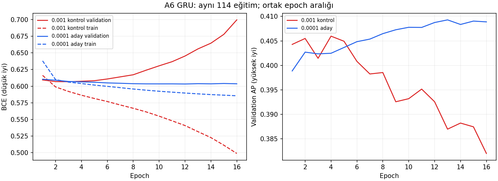

# A6 öğrenme hızı sonucu — 28 Ekim 2026

Düşük öğrenme hızı eğitimdeki bozulmayı yavaşlattı ve aynı dönemde seedler
arasındaki metrik farkını azalttı. Ancak seçilen checkpointlerin ortalama
validation başarımı artmadı. A6 için 0.0001'i yeni kazanan ilan etmiyoruz.

## Kanıt ve kapsam

- Drive: [A6 raporları](https://drive.google.com/drive/folders/17u9EUjqHRO-RlsLbS5QE58ObmMQKwale),
  `learning_rate_review.zip`; SHA256 [checks.json](checks.json) içinde.
- 38 fold × 3 seed = **114/114 tamamlanmış eğitim**. Her birinde history,
  validation metrics ve 1017 satırlık prediction mevcut. ZIP CRC geçti.
- Eski A6 kontrolünün 342 dosya hash'i orijinal arşivle eşleşti. Aynı veri,
  özellikler, etiket, bölmeler, motor ve runtime; config farkı yalnızca
  öğrenme hızı ve çıktı yolu. A100, GRU6, 2/5 ATR, 10 bar korunmuş.
- Epoch seçimi minimum validation BCE, patience 15, üst sınır 100.
  Seçilen epoch, geçmiş ve tahmin metrikleri doğrulandı. İki eğitim 100 epoch
  sınırına ulaştı; bu, tanımlı bütçe içinde tamamlanmadır, yakınsama kanıtı değildir.
- **Test değerlendirmesi 0**. Ağırlıklar ZIP'te bulunmadığından checkpoint
  dosyalarının kendileri veya ileri geçişi tekrar doğrulanmadı.
- Tekrarlanabilir denetim: depo kökünden `python research/analyses/a6-learning-rate-20261028/review.py`.
  Script yeni ZIP'i Downloads'ta `learning_rate_review (1).zip`, kontrolü
  `reports/early-epochs-20261024/source.zip` altında bekler; paket kurulumu yapmaz.

## En iyi checkpointler: aynı ölçümle dört koşul

BCE/AP ve best epoch, 114 fold-seed kaydının eşit ağırlıklı ortalamasıdır.
B37 kanıtı [önceki incelemede](../learning-rate-review-20261024/REPORT.md).

| Model | LR | BCE ↓ | AP ↑ | Ortalama best epoch |
|---|---:|---:|---:|---:|
| A6 GRU | 0.001 | 0.594332 | 0.421212 | 4.44 |
| A6 GRU | 0.0001 | 0.594545 | 0.419869 | 16.30 |
| B37 GRU | 0.001 | 0.609470 | 0.404929 | 1.37 |
| B37 GRU | 0.0001 | 0.601146 | 0.410256 | 4.76 |

A6'da BCE 0.000213 kötüleşti, AP 0.001344 düştü; küçük farklar.
114 eşleşmenin 64'ünde BCE, 58'inde AP, yalnızca 40'ında ikisi birlikte iyileşti.
Dolayısıyla düşük LR'nin B37'deki faydası A6'ya aynı şekilde taşınmadı.
Aynı düşük LR'de A6, B37'yi 71/114 eşleşmede BCE ve 68/114'te AP açısından geçti;
genel ortalamada da önde, fakat bütün dönemlerde değil. Bu dört koşulun özeti
C/D mimarileri için yeni bir sonuç değildir.

## Erken best epoch ve seed sorunu

Sol grafikte düşük LR'nin validation BCE'si daha yavaş bozuluyor; sağda AP
daha uzun süre korunuyor. Grafik **aynı epoch numarasını** karşılaştırır.
Yavaş modelin 16. epochta daha iyi olması, eski modelin 4. epochta saklanan
en iyi ağırlığından daha iyi olduğu anlamına gelmez. Üstteki tablo her eğitimin
kendi seçilen checkpointini karşılaştırır; karar için bu ayrım önemlidir.

- Best epoch medyanı **4 → 13**, ortalaması **4.44 → 16.30** oldu.
  Buna karşın ilk epoch seçilen eğitim sayısı 17 → 21; tüm dönemlerde çözülmedi.
- Aynı fold içindeki üç seedin BCE aralığının medyanı **0.00717 → 0.00365**;
  AP aralığı **0.03161 → 0.01348**. Metrik kararlılığı belirgin iyileşti.
- Yeni 114 eğitimin hepsinde best epoch sonrasında son epochta train BCE daha
  düşük, validation BCE daha yüksek. AP de 89/114 eğitimde best'ten sona düştü.
  Early stopping sonrasında daha yüksek BCE kısmen seçim kuralının beklenen
  sonucudur; tek başına neden kanıtı değildir. Train/validation ayrışmasıyla
  birlikte aşırı uyuma uyumludur.

**Doğrulanmış etki:** Bu koşullarda LR düşürmek öğrenme/bozulma zamanlamasını
değiştirdi ve seedler arası metrik farkını azalttı.
**Henüz kanıtlanmayan:** Sorunun tek nedeni LR, özelliklerde bilgi yok veya
belirli bir yeni mimari çözüm olacak iddiaları. Epoch sayısı tek başına kalite değildir.

## 0.5 eşikte seçici sinyaller

Bu tabloda precision/recall/F1, tüm fold-seed tahminlerindeki TP/FP/FN
sayılarının toplamından hesaplanır. Notebook summary.csv ise eğitim başına
metriklerin ortalamasını verir; özellikle sıfır sinyalli kayıtlarda precision=0
kabulü nedeniyle iki tablo aynı sayı değildir.

| A6 | Precision | Recall | F1 | Sinyal oranı | Sinyalsiz eğitim |
|---|---:|---:|---:|---:|---:|
| LR 0.001 | %48.74 | %9.19 | %15.47 | %5.86 | 14/114 |
| LR 0.0001 | %48.56 | %7.11 | %12.40 | %4.54 | 35/114 |

Daha az sinyal karşılığında precision artışı yok. Son fold 37'de eski
seed 42/43/44 sinyal sayıları 4/21/17 iken yenide **0/0/6**.
Aynı foldun yeni AP'leri 0.3722/0.3799/0.3840 ile eskilerinden yüksek olmasına
rağmen eşik üstü sinyal çok az: sıralama başarısı ile sabit eşikte sinyal üretimi
aynı şey değildir. LR deneyi bu sinyalsizlik sorununu çözmedi.

## Karar ve sonraki soru

Eğitimleri eksik dosya nedeniyle tekrar çalıştırmaya gerek yok. Eski A6
referansı korunuyor; yeni aday kararlılık açısından faydalı ama başarım ve
sinyal üretimi açısından kesin üstün değil. Yeni eğitim başlatılmadı.

En küçük sonraki adım, mevcut A6 tahminleriyle eski/yeni LR'nin **aynı sinyal
oranındaki precision'ını ve dönem başına sinyal kapsamını** karşılaştırmak.
Bu, 0.5 altına kaymış skoru kalite kaybından ayırır; B37'de yapılan analizle
aynı sorudur. Burada yeni eşik seçilmedi ve final teste geçilmedi.

Validation daha önce epoch seçimi ve çoklu analizler için kullanıldı; sonuçlar
bağımsız final performansı değildir. Örtüşen foldlar ve seedler nedeniyle
toplam sinyaller bağımsız/benzersiz işlemler değildir. İstatistiksel anlamlılık
ve ekonomik kârlılık iddiası yapılmıyor.
