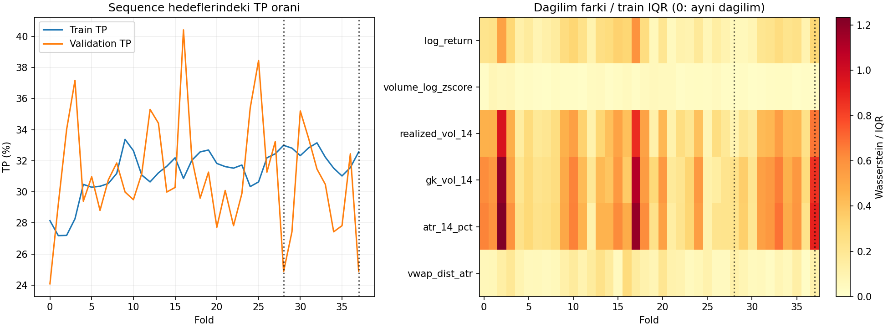

# A6 dönem teşhisi: fold 28 ve 37 neden farklı?

28 Ekim 2026 · exp-029 · exp-028 eşik incelemesinin devamı.

**Sonuç:** Sadece özellik dağılımı değişimi veya TP oranı düşüşü iki dönemin
başarım farkını açıklamıyor. Fold 28'de volatilite ile etiket arasındaki
tekil ilişkiler zayıflıyor; BCE seçimi de sonraki epochlarda yükselen AP'yi
tercih etmiyor. Bunlar gözlemdir; modelin iç kararlarının kesin nedenini
veya yeni bir yöntemin çözüm olacağını kanıtlamaz.

## Veri ve kontrol

Drive hesabı icinbedava34@gmail.com doğrulandı. Eğitimde kullanılan
[shared37.parquet](https://drive.google.com/file/d/14kXQEYSUVQY2rwWD4YFSYTiCRZUrs4B6/view)
indirildi; SHA256 ce49f694d8e7d1c860f0b16ef49c8ec48ed072404c4f8b2991fc8945584c0653
orijinal protokolle aynı. Dosya Git dışında reports/ altında korunuyor.

33.551 saatlik hazırlanmış veri; 38 fold. Dondurulmuş split/dataset kod
hash'leri doğrulandı. Train 5040, validation 1080 satır; 64'lük dizilerden
sonra 4977/1017 hedef. Validation tarih, etiket ve konumları 114 orijinal
tahmin dosyasıyla eşleşti. LR adayının aynı kimlikleri önceki incelemede
doğrulanmıştı. Veri yeniden üretilmedi; hiçbir test dilimi değerlendirilmedi.

Özellik dağılımları tüm train/validation giriş satırlarında; etiket oranları
ilk 63 bağlam satırı çıkarılmış hedeflerde hesaplandı. Özellikler tekil satır
olarak incelendi, örtüşen 64'lük dizilerde kaç kere kullanıldığıyla ağırlıklandırılmadı.
Bu rapordaki dağılım ölçümü scaler veya model girdisi değişikliği değildir.

## Benzer etiket değişimi, farklı sonuç

| Ölçüt | Fold 28 | Fold 37 |
|---|---:|---:|
| Validation hedef tarihleri (UTC) | 17 Ocak–1 Mart 2025 | 14 Ekim–26 Kasım 2025 |
| Train TP oranı | %32.99 | %32.57 |
| Validation TP oranı | %24.88 | %24.88 |
| TP oranı değişimi | −8.11 puan | −7.69 puan |
| Yeni LR AP, 3 seed ortalaması | 0.2645 | 0.3787 |
| Yeni LR top %5 precision | %10.46 | %50.33 |
| Eski LR top %5 precision | %38.56 | %35.95 |
| Yeni LR best epoch, üç seed | 1/1/1 | 2/2/2 |

İki dönemde TP oranı aynı olmasına rağmen seçici sıralama çok farklı.
Etiket dağılımının değişmesi önemlidir ama bu karşılaştırmayı tek başına açıklamaz.
Fold 28'in ham validation satır TP oranı %27.50, hedef oranı %24.88'dir;
bu fark ilk 63 bağlam satırından gelir, veri hizası hatası değildir.

## Özellik dağılımı ne kadar değişmiş?

Sağ grafikte train ve validation arasındaki Wasserstein uzaklığı train
çeyrekler arası genişliğine (IQR) bölündü. Sıfır aynı marjinal dağılım demektir;
büyük değer daha fazla değişimdir. Evrensel alarm eşiği kullanılmadı.

| Özellik | Fold 28 uzaklık/IQR | Fold 37 uzaklık/IQR |
|---|---:|---:|
| log_return | 0.063 | 0.305 |
| volume_log_zscore | 0.026 | 0.025 |
| realized_vol_14 | 0.092 | 0.673 |
| gk_vol_14 | 0.235 | 0.858 |
| atr_14_pct | 0.224 | 0.902 |
| vwap_dist_atr | 0.116 | 0.113 |

Altı özellik ortalaması fold 28'de 0.126, fold 37'de 0.479.
Fold 37 bütün 38 dönem içinde üçüncü en yüksek ortalama değişime sahip,
ama yeni model orada daha iyi sıralıyor. Dolayısıyla **büyük marjinal dağılım
değişimi = başarısız model** açıklaması desteklenmiyor.

38 fold genelinde yeni modelde ortalama dağılım uzaklığı ile AP/TP-oranı
oranı arasındaki Spearman korelasyonu 0.004; top-%5 precision ile 0.208.
Bunlar betimleyici değerlerdir; örtüşen foldlarla anlamlılık veya nedensellik
iddiası yapılmıyor. Ortak çok değişkenli veya zamansal dağılım değişimi bu
tekil ölçülerle dışlanamaz.

## Girdilerin etikete ilişkisi değişiyor mu?

Hedef satırındaki tekil özellik ile ikili etiket arasındaki Spearman ilişki:

| Özellik | Fold 28 train → val | Fold 37 train → val |
|---|---|---|
| realized_vol_14 | −0.175 → −0.062 | −0.156 → −0.161 |
| gk_vol_14 | −0.198 → −0.063 | −0.163 → −0.212 |
| atr_14_pct | −0.194 → −0.058 | −0.163 → −0.203 |
| vwap_dist_atr | +0.061 → −0.077 | +0.036 → −0.054 |

Fold 28'de volatilite–TP ilişkisi zayıflarken fold 37'de korunuyor veya
güçleniyor. Bu, yalnız dağılımın konumuna bakmaktan daha açıklayıcı bir ipucu.
Ancak GRU 64 satırlık diziler ve etkileşimler kullanır; tekil korelasyon
modelin o özelliğe dayandığını kanıtlamaz. VWAP ilişkisinin işaret değişimi
iki dönemde de var; farkı tek başına açıklamaz. Ham altı özelliği çıkarmak,
yeniden ölçeklemek veya yenisini eklemek için bu gözlem tek başına yeterli değil.

## BCE neden iyi görünürken seçici sinyal kötü olabilir?

Fold 28 yeni LR ortalama BCE'si 0.57247. Train TP oranını her örneğe sabit
skor olarak veren referansın validation BCE'si 0.57662: iyileşme yalnızca
0.00416. Fold 37'de karşılıkları 0.54309 ve 0.57511: iyileşme 0.03202.
Bu sabit referans yeni model değildir; train etiket oranıyla yapılan tanısal
bir hesaplamadır. Yeni model her örneğe aynı skor vermiyor; hesap yalnız
ortalama BCE kazancının boyutunu gösterir.

Fold 28'de mevcut epoch geçmişleri başka bir ayrımı gösteriyor:

| Seed | BCE'nin seçtiği epoch / AP | Kaydedilen en yüksek AP epoch / AP | O epochun BCE'si |
|---|---|---|---:|
| 42 | 1 / 0.2646 | 16 / 0.3090 | 0.58476 |
| 43 | 1 / 0.2639 | 13 / 0.3107 | 0.58444 |
| 44 | 1 / 0.2649 | 15 / 0.3137 | 0.58074 |

Sıralama sonraki epochlarda gelişirken BCE kötüleşiyor. BCE, olasılık
skorlarının bütün örneklerdeki kaybını; AP, pozitifleri yukarı sıralamayı
ölçüyor. İkisi aynı epochu seçmek zorunda değil. **Bu fold'da BCE seçiminin
AP açısından bir bedeli olduğu doğrulandı.** Ama AP ile seçmenin yüksek
precision veya dönem kararlılığı sorununu çözeceği doğrulanmadı; AP maksimumu
da aynı validation üzerinde sonradan incelendi. O epochların tahminleri
saklanmadığı için top-%5 başarımını hesaplamadık ve ağırlıkları değiştirmedik.

Fold 37'de 2. epoch üç seed'de de BCE seçimi; iki seed'de aynı zamanda AP
maksimumu. Demek ki ölçüt ayrışması bütün dönemlerde aynı değil.

## Karar

1. Bu kontrollerde veri kimliği, bölme veya hedef hizalama hatası bulunmadı.
   Bu, tüm özellik üretim zincirinin sızıntısızlığının yeni bir denetimi değildir.
2. Fold 28 sorunu sadece eşik veya etiket oranından kaynaklanmıyor.
   Etiketle ilişkilerin değişimi ve BCE/AP epoch ayrışması somut ipuçları.
3. Şimdi yeni mimari yerine, **mevcut 114 eğitim geçmişinin tamamında BCE
   seçimi ile AP ilerleyişinin ne sıklıkla ayrıştığını** incelemek en küçük
   sonraki adımdır. Sadece kötü fold 28'e bakarak seçim kuralı değiştirilmemeli.
4. AP temelli checkpoint seçimi bir yöntem değişikliğidir; burada uygulanmadı.
   Böyle bir kontrollü deney gerekirse önce kapsamı ve değerlendirme bölümü
   belirlenmeli. Eski sonuçlar, ağırlıklar ve test sınırı korundu.

## Tekrar üretim ve sınırlar

`python research/analyses/a6-period-diagnosis-20261028/analyze.py`
yerel indirilen veri, orijinal review ZIP ve Downloads'taki yeni A6 ZIP'ini
kullanır. CSV'ler bütün 38 foldu kapsar; epoch_tradeoff.csv yalnızca iki
odak foldun mevcut geçmişlerini içerir. Paket kurulumu veya eğitim yok.

Dosya hash'i, saat düzeni, dondurulmuş bölme kodu, 114 tahmin hizası ve
4977/1017 hedef sayısı kontrolleri geçti. Tek grafik görsel olarak incelendi.
Validation yeniden kullanılıyor; foldlar örtüşüyor; iki odak dönem sonuçlar
görüldükten sonra seçildi. Bulgular keşifseldir, kesin neden veya bağımsız
test başarımı değildir. Veri/model dosyaları Git'e eklenmedi.
