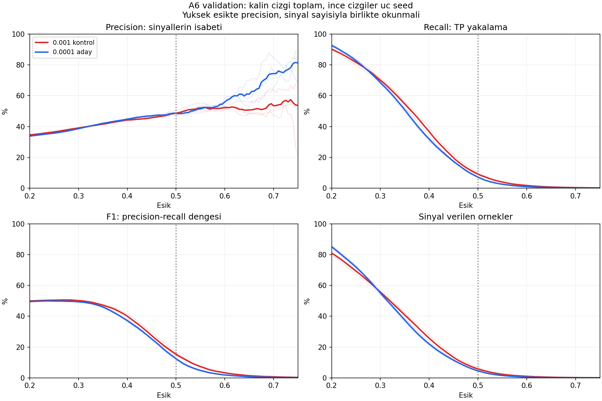
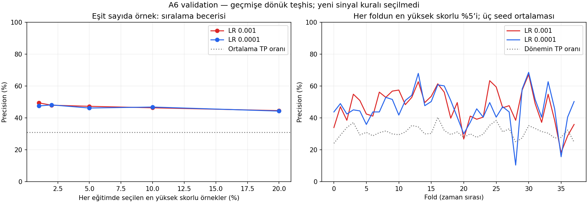

# A6: eşik, aynı sinyal sayısı ve dönem kararlılığı

28 Ekim 2026 · exp-028-a6-thresholds · Önceki deney: exp-027-a6-learning-rate.

**Öğrendiğimiz:** Düşük öğrenme hızı üst skorları aşağı çekiyor ve seed
oynaklığını azaltıyor. Ancak aynı sayıda örnek seçildiğinde genel precision
üstünlüğü yok. Bazı dönemlerde sorun eşik/skor ölçeği; bazı dönemlerde ise
gerçekten zayıf sıralama. Tek bir eşiği değiştirmek ikisini birden çözmüyor.

## Ne karşılaştırıldı?

A6 GRU, aynı 6 özellik, 2/5 ATR ve 10 bar; LR 0.001 ve 0.0001.
38 fold × 3 seed, her koşulda 115.938 validation tahmin kaydı.
Minimum validation BCE ile önceden seçilen ağırlıkların mevcut tahminleri
kullanıldı. Yeni eğitim, model, kalibrasyon, ensemble veya final test yok.

Üç farklı bakış birbirine karıştırılmamalı:

1. **Aynı sayısal eşik:** örneğin iki modelde de 0.5.
2. **Yaklaşık aynı genel sinyal oranı:** eski eşikte seçilen kayıt sayısına
   yakın sayıyı yeni modelin hangi eşiği veriyor? 0–1, adım 0.005 tarandı;
   eşleştirmede precision veya etiket kullanılmadı.
3. **Her fold/seed içinde aynı sayıda örnek:** her modelin en yüksek skorlu
   %1/%2/%5/%10/%20 örneği. Bu geçmişe dönük sıralama teşhisidir; gelecekte
   uygulanacak bir eşik veya zorunlu işlem kotası değildir. Cutoff tüm
   validation skorları görüldükten sonra hesaplandığı için canlı kural sayılamaz.

TP/FP/FN sayıları fold-seed kayıtları üzerinde toplanmıştır. Örtüşen dönemler
ve aynı örneğin farklı seedlerde bulunması nedeniyle sayılar benzersiz veya
bağımsız işlem sayısı değildir. Sinyal yoksa precision tanımsızdır; başarı
sayılmaz. AP/BCE eşik değiştirmekle değişmez: eski/yeni AP 0.42121/0.41987,
BCE 0.59433/0.59455. Ham skor, kalibre edilmiş başarı olasılığı değildir.

## 1. Eşik yükseldikçe ne oluyor?

Kalın çizgiler toplam sayımları, ince çizgiler seed bazındaki sonuçları
gösterir. F1 burada raporlama ölçütüdür; seçim hedefi değildir.

| LR | Eşik | Precision | Recall | F1 | Sinyal kaydı | Sinyalsiz run /114 |
|---|---:|---:|---:|---:|---:|---:|
| 0.001 | 0.40 | %44.22 | %36.63 | %40.07 | 29.815 | 2 |
| 0.0001 | 0.40 | %44.83 | %31.79 | %37.20 | 25.525 | 8 |
| 0.001 | 0.45 | %45.71 | %19.66 | %27.50 | 15.486 | 5 |
| 0.0001 | 0.45 | %46.90 | %17.32 | %25.30 | 13.294 | 17 |
| 0.001 | 0.50 | %48.74 | %9.19 | %15.47 | 6.789 | 14 |
| 0.0001 | 0.50 | %48.56 | %7.11 | %12.40 | 5.268 | 35 |
| 0.001 | 0.55 | %52.04 | %3.96 | %7.36 | 2.740 | 35 |
| 0.0001 | 0.55 | %51.52 | %2.54 | %4.85 | 1.778 | 46 |
| 0.001 | 0.60 | %52.18 | %1.73 | %3.34 | 1.190 | 60 |
| 0.0001 | 0.60 | %56.00 | %0.97 | %1.91 | 625 | 74 |

Eşiği azaltmak recall ve kapsamı yükseltir; modelin AP'sini veya bilgiyi
ayırt etme kapasitesini yükseltmez. 0.45'teki küçük precision farkı da yeni
modelin daha az örnek seçtiği gerçeğiyle birlikte okunmalı.

**Yüksek precision tuzağı:** Yeni modelde 0.65 eşiği %61.01 precision verir,
ama 218 kayıt ve 93 sinyalsiz run vardır. 0.70'te %74.39 precision yalnızca
82 kayıttaki 61 TP'den gelir; 105/114 run sessizdir. Sinyaller yalnızca
4/38 folda yayılır; %97.56'sı üç folddadır. Seed 42/43/44 precision'ları
%84.62/%65.71/%76.19, dayanak sayıları sadece 26/35/21'dir. Bu bölgeyi
kararlı %70+ başarı veya kullanıma hazır eşik diye sunamayız.

## 2. Aynı genel sinyal oranında üstünlük var mı?

| Eski → yeni eşik | Eski → yeni sinyal oranı | Eski → yeni precision | Sinyalsiz run |
|---|---|---|---|
| 0.40 → 0.385 | %25.72 → %26.12 | %44.22 → %43.98 | 2 → 4 |
| 0.45 → 0.440 | %13.36 → %13.25 | %45.71 → %46.75 | 5 → 16 |
| 0.50 → 0.490 | %5.86 → %5.62 | %48.74 → %48.39 | 14 → 31 |
| 0.55 → 0.530 | %2.36 → %2.36 | %52.04 → %49.93 | 35 → 39 |
| 0.60 → 0.570 | %1.03 → %1.01 | %52.18 → %52.27 | 60 → 54 |

Grid nedeniyle eşleşme yaklaşık. Yeni modelde 0.49 eşiği eski 0.5'in
genel kapsamına yaklaşıyor fakat precision artmıyor ve sessiz run sayısı
hâlâ iki kattan fazla. **Genel sinyal sayısını eşitlemek, sinyallerin dönemlere
eşit yayılmasını sağlamıyor.** Bunlar önerilen eşikler değil, karşılaştırma noktaları.

Skor ölçeği kanıtı: run bazındaki skor yüzdeliklerinin ortalamaları:

| Skor yüzdeliği | Eski | Yeni |
|---|---:|---:|
| Medyan | 0.3202 | 0.3158 |
| %90 | 0.4631 | 0.4461 |
| %95 | 0.4964 | 0.4763 |
| %99 | 0.5516 | 0.5202 |

Üst skorların daha belirgin azalması, sabit 0.5'in yeni modelde daha az sinyal
vermesini açıklayan doğrudan gözlemdir. Bu tek başına kalibrasyonun iyileştiği
veya kötüleştiği anlamına gelmez.

## 3. Her dönemde aynı sayıda örnek seçince?

| Her run'da seçilen oran | Örnek/run | Eski precision | Yeni precision |
|---|---:|---:|---:|
| Yaklaşık %1 | 10 | %49.47 | %47.54 |
| Yaklaşık %2 | 20 | %48.03 | %48.20 |
| Yaklaşık %5 | 51 | %47.32 | %46.25 |
| Yaklaşık %10 | 102 | %46.39 | %46.86 |
| Yaklaşık %20 | 203 | %44.62 | %44.33 |

Genel pozitif etiket oranı %31.05; modeller yüksek skorlarla TP örneklerini
zenginleştirebiliyor. Fakat düşük LR'nin farklı kapsam seviyelerinde tutarlı
üstünlüğü yok. Top %5'te 114 eşleşmenin 53'ünde yeni daha iyi, 54'ünde eski
daha iyi, 7'sinde eşit. Aynı fold içinde seedler arası precision aralığının
medyanı **11.76 → 5.88 yüzde puana** düşüyor. Daha kararlı olmak ile daha
başarılı olmak farklı: yeni model bazen daha kararlı biçimde kötü sıralıyor.

### Son fold: esas sorun 0.5'in üstüne çıkamamak

Fold 37 validation: 14 Ekim–26 Kasım **2025** (UTC; ayrıntılı saatler periods.csv).
Bu, final test dönemi değildir. Her seed için en yüksek skorlu 51 örnek:

| Seed | Eski precision | Yeni precision | Yeni top-51 cutoff |
|---|---:|---:|---:|
| 42 | %35.29 | %52.94 | 0.4263 |
| 43 | %25.49 | %49.02 | 0.4405 |
| 44 | %47.06 | %49.02 | 0.4629 |

Yeni modelin 0.5'te 0/0/6 sinyal üretmesi, hiç sıralama becerisi olmadığı
anlamına gelmiyor. Bu dönemde TP oranı %24.88; top-51'de %49–53 TP var.
Ancak bu cutoff'lar sonradan bulundu; gelecekte aynı sonucu verecek seçilmiş
eşikler değildir.

### Karşı örnek, fold 28: eşik değişikliği tek başına çözüm değil

Aynı top-51 karşılaştırmasında eski seed precision'ları %33.33/%47.06/%35.29,
yeniler **%3.92/%11.76/%15.69**. Dönemin TP oranı %24.88.
Yeni model en yüksek skorlarında bile TP'yi yeterince sıralayamıyor.
Buradaki kötü sonuç yalnızca 0.5'in yüksek kalmasıyla açıklanamaz. Bu
örnek neden araştırması için seçilmiş karşı örnektir, tüm dönemlerin özeti değil.

## Ne öğrendik, ne henüz bilinmiyor?

- LR, öğrenmenin ve validation bozulmasının hızına etki ediyor; önceki eğri
  analizi bunu gösterdi. Daha geç best epoch otomatik kalite artışı değil.
- Seed etkisinin bir kısmı azalıyor; dönemler arası büyük farklar sürüyor.
- Sinyalsizlik ile sıralama başarısızlığı aynı problem değil. Son fold ve
  fold 28 bunu birbirinden ayırıyor. Her ikisine tek bir genel eşik çözüm olmaz.
- F1 düşüklüğünün önemli mekanizması yüksek eşikte çok az pozitif örneği
  yakalamak. Eşiği düşürmek bunu değiştirir, fakat seçici sinyal hedefini
  precision ve dönem kapsamıyla birlikte değerlendirmek gerekir.
- Mevcut kanıtla A6 için düşük LR'yi kazanan veya kalıcı yeni varsayılan
  yapmıyoruz. Eski A6 referansı korunuyor. Eşik seçilmedi.
- Neden belirli dönemlerde sıralamanın bozulduğu bu analizle kanıtlanmadı.
  Rejim değişimi, zayıf özellikler veya train-validation farkı ancak sonraki
  kontrollü teşhislerin hipotezidir; sonuç gibi sunulmamalı.

Sonraki küçük adım önerisi: yeni mimari eğitmeden, fold 28 ve son foldun
train/validation etiket oranı ve mevcut altı özelliğinin dağılım farklarını
incelemek; bütün foldların bağlamında karşılaştırmak. Bu rapor kapsamında
yeni ön işleme, kalibrasyon veya eşik kuralı uygulanmadı.

## Kanıt ve doğrulama

`analyze.py` iki yerel ZIP'teki 114 eşleşen validation kimliğini kontrol eder;
0.5 sayımları önceki doğrulanmış metriklerle eşleşir, sinyal sayıları eşik
arttıkça azalır. Top-k sınırında eşit skor bulunmadı. Kaynak SHA256'ları
checks.json'da; koşul denetimi önceki [A6 raporunda](../a6-learning-rate-20261028/REPORT.md).
Tam test paketi veya ML eğitimi çalıştırılmadı. Sayısal kontrol ve iki grafik
ile sınırlı mevcut tahmin analizi yapıldı.

Yeniden üretim: depo kökünden `python research/analyses/a6-thresholds-20261028/analyze.py`.
ZIP konumları scriptte açıktır; bağımlılık kurmaz. thresholds*.csv eşik
sonuçlarını; matched*.csv eşit kapsamı; periods.csv dönemleri;
score_quantiles_by_run.csv skor ölçeğini saklar.

Validation epoch seçiminde ve tekrarlanan incelemelerde kullanıldı. Rapor
keşifseldir; bağımsız genelleme, istatistiksel anlamlılık veya ekonomik
kârlılık kanıtı değildir. Yüksek eşiklerde düşük destek ve örtüşme nedeniyle
bağımsız örnek varsayımıyla güven aralığı üretilmedi.
