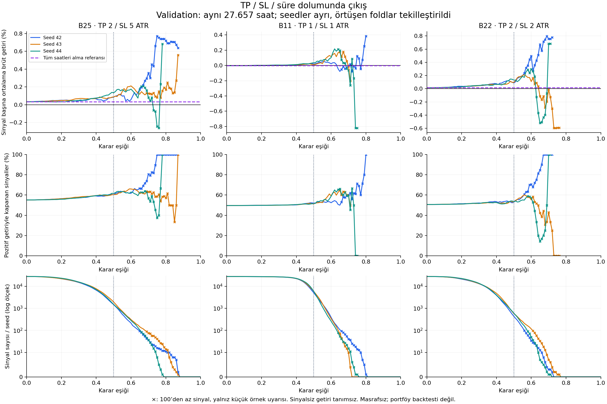
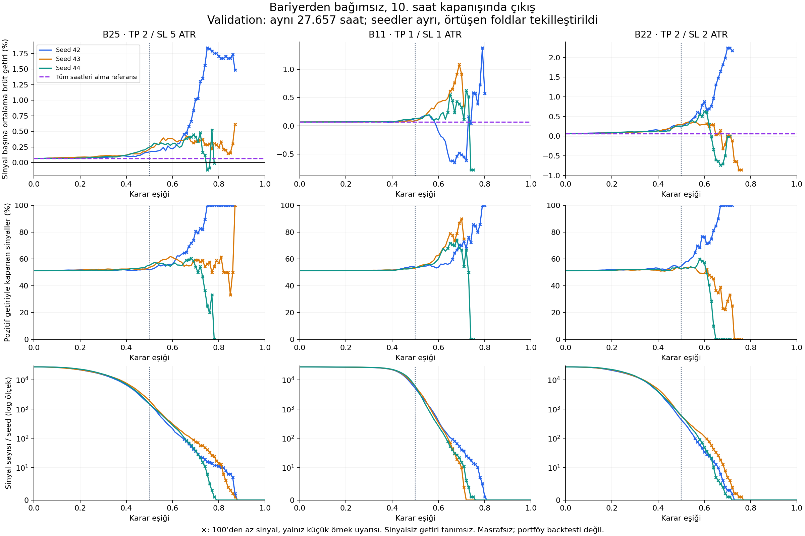

# Bariyerler ve sinyallerin ekonomik anlamı

22 Ekim 2026 · Mevcut A6 GRU validation tahminleri · B25 / B11 / B22.
Yeni eğitim, final test veya eşik seçimi yapılmadı.

## Sonuç

2/5'in özel bir bilimsel gerekçeyle seçildiğine ilişkin kayıt bulamadık;
başlangıç pipeline'ında mevcut ve sonraki deneylere korunarak taşınmış.
Literatür volatiliteye göre ölçeklemeyi destekliyor; evrensel bir 2/5 oranı
önermiyor. [Kaynaklar, tarihçe ve yöntem önerisi](LITERATURE.md).

Ekonomik incelemede genel dönem ortalamaları umut verici görünse de dönem
ve seed kararlılığı sorunu devam ediyor. **Yüksek kazanma oranı, yüksek
ortalama getiri ve yeterli sinyal sayısı aynı şey değil.** Bariyer veya eşik
kazananı belirlemek için bu rapor yeterli değil.

## Ne hesaplandı?

Her adayda 38 fold × 3 seed = 114 mevcut validation dosyası doğrulandı.
Bir adayın 115.938 tahmin kaydı aynı saatleri tekrar içeriyor. Ana görünümde
her seed/timestamp için en yüksek fold numaralı validation tahmini tutuldu;
skora veya getirisine göre seçim yapılmadı. Böylece her seed için aynı
27.657 validation saati karşılaştırılıyor. **Bu toplulaştırma eski 114 grup
eşit ortalamasıyla aynı değildir; eski görünüm aşağıda ayrıca verilmiştir.**

İki ayrı çıkış hesabı:

1. **Bariyer çıkışı:** sinyal mumunun kapanışından giriş; önce TP veya SL
   görülürse o bariyer fiyatından, ikisi de görülmezse 10. saatin kapanışından
   çıkış. Aynı mumda iki temas varsa mevcut etiketlemedeki gibi SL önce.
2. **10 saat kapanışı:** aradaki TP/SL temaslarından bağımsız olarak 10.
   saatin kapanış getirisi. Bariyer etiketleme ile aynı yatırım kuralı değildir.

Her iki hesap da brüt: ücret, slippage, funding ve gap kaynaklı farklı
gerçekleşme fiyatı yok. Saatlik sinyallerin pozisyonları çakışabilir;
bu nedenle sayılar **varsayımsal sinyal/işlem fırsatlarıdır**, tek pozisyonlu
bir stratejide gerçekleşecek bağımsız işlem sayısı değildir. Birikimli getiri,
Sharpe veya portföy getirisi hesaplanmadı.

## 0,50 eşikte anlaşılır karşılaştırma

Önce her seed'in seçtiği örneklerin ortalaması, sonra üç seed'in eşit
ortalaması alındı. Sinyal sayısı seed başına ortalamadır; parantez aralığı
üç seed'in en az/en çok sinyalidir. Kazanma = getirinin sıfırdan büyük olması.

| Bariyer | Sinyal / seed | Ortalama bariyer getirisi | Kârla kapanma | TP'ye önce ulaşma | Ortalama 10 saat getirisi |
|---|---:|---:|---:|---:|---:|
| 2/5 | 1.647 (1.479–1.944) | +%0,1022 | %60,81 | %49,08 | +%0,2104 |
| 1/1 | 5.620 (5.100–5.882) | +%0,0216 | %51,66 | %48,60 | +%0,1025 |
| 2/2 | 537 (434–602) | +%0,1046 | %53,23 | %43,24 | +%0,2596 |

Örneğin 2/5'te %49,08 TP teması ile %60,81 kârla kapanma çelişmiyor:
bazı timeout örnekleri TP'ye ulaşmadan pozitif getiriyle kapanıyor.

Model kullanmadan aynı bütün validation saatlerini alma referansının bariyer
getirisi: 2/5 için +%0,0331; 1/1 için −%0,0040; 2/2 için +%0,0151.
Dolayısıyla 0,50 sinyal filtresinin bu referansa farkı sırasıyla
**+0,0692 / +0,0257 / +0,0895 yüzde puan**. Bu karşılaştırma sinyal
seçiminin katkısını gösterir; nedensel etki veya bağımsız başarı kanıtı değildir.
Üç adayın tüm saatler için ortak 10 saat kapanış referansı +%0,0665'tir.

1/1 daha fazla fırsat seçiyor ama sinyal başına ortalama getirisi düşük.
2/2'nin ortalama getirisi 2/5'e çok yakın fakat daha az sinyalle elde edilmiş.
Bu tablodan tek başına birini üstün ilan etmek doğru değil.

## Eşiği yükseltmek ne yapıyor?

| Bariyer | Eşik | Sinyal / seed ortalaması | Bariyer getirisi | Kârla kapanma |
|---|---:|---:|---:|---:|
| 2/5 | 0,40 | 7.141 | +%0,0703 | %59,34 |
| 2/5 | 0,50 | 1.647 | +%0,1022 | %60,81 |
| 2/5 | 0,60 | 268 | +%0,1478 | %63,56 |
| 1/1 | 0,40 | 22.419 | +%0,0092 | %50,45 |
| 1/1 | 0,50 | 5.620 | +%0,0216 | %51,66 |
| 1/1 | 0,60 | 330 | +%0,0812 | %56,80 |
| 2/2 | 0,40 | 4.234 | +%0,0689 | %52,90 |
| 2/2 | 0,50 | 537 | +%0,1046 | %53,23 |
| 2/2 | 0,60 | 66 | +%0,2993 | %60,97 |

Eşik yükselirken ortalama getiri artabiliyor, fakat örnek sayısı hızla azalıyor.
2/2'nin 0,60'taki yüksek ortalaması seed başına yalnız 34–116 sinyale dayanıyor.
0,70'te bu sayı **1–7**: %0,4764 ortalama görünüyor ama seedlerden birinin
ortalaması negatif. Bu bölgeyi sağlam başarı diye yorumlayamayız.

1/1'de 0,70 eşik daha çarpıcı: kazanma ortalaması **%60**, fakat ortalama
bariyer getirisi **−%0,0252**; seed başına 10–40 sinyal var. Kazanma sayısı
ile kazanç/kayıp büyüklüğü aynı bilgi değildir. ATR/fiyat girişten girişe
değiştiği için simetrik ATR bariyerleri yüzde bazında sabit ödeme üretmez.

**Okuma sırası:** üst sıra sinyal başına getiri; orta sıra pozitif getiri
oranı; alt sıra kaç sinyal kaldığı. Her renk ayrı seed. Mor kesikli çizgi
model filtresi olmadan bütün saatleri alma referansı. Dikey çizgi 0,50.
× işareti 100'den az sinyali belirtir; bu yalnız görsel küçük-örnek uyarısıdır,
önceden kanıtlanmış yeterlilik sınırı değildir. Sinyal yoksa getiri çizgisi kesilir.
Getiri panellerinin dikey ölçekleri farklıdır; sayısal değerlere bakılmalıdır.

İkinci grafik aynı sinyallerin 10 saat sonundaki getirilerini gösterir.
Bariyerde erken çıkıştan daha yüksek görünmesi, canlı uygulamada 10 saat
tutmanın daha iyi olduğuna dair bağımsız test değildir.

## Genel ortalamanın gizlediği sorun

### Eski fold/seed eşit ağırlık görünümü, eşik 0,50

Sinyali olan her fold/seed'e eşit ağırlık verildiğinde:

| Bariyer | Sinyalli grup / 114 | Pozitif ortalamalı grup / sinyalli grup | Ortalama bariyer getirisi |
|---|---:|---:|---:|
| 2/5 | 100/114 | 60/100 | +%0,0051 |
| 1/1 | 113/114 | 72/113 | +%0,0170 |
| 2/2 | 79/114 | 46/79 | +%0,0088 |

Bu rakamlar ilk tablodan belirgin farklıdır. İlk tablo tekilleştirilmiş
saatlerde sinyal başına ortalama; bu tablo sinyal sayısı 4 olan bir gruba
400 olan grupla aynı ağırlığı verir ve örtüşen foldları ayrı tutar.
**Dönemler arasında tutarlı üstünlük yok; toplulaştırma değişince sıralama da
değişiyor.** Sinyalsiz grupları sıfır getirili işlem saymadık, tanımsız bıraktık.

### Son fold, eşik 0,50

| Bariyer | Seed 42: sayı / getiri | Seed 43: sayı / getiri | Seed 44: sayı / getiri |
|---|---:|---:|---:|
| 2/5 | 4 / −%0,5980 | 21 / −%0,3757 | 17 / +%0,2141 |
| 1/1 | 184 / −%0,3370 | 484 / −%0,2820 | 8 / −%0,1092 |
| 2/2 | 4 / −%1,0017 | 0 / tanımsız | 0 / tanımsız |

1/1'de sorun yalnızca iki-üç örneklik rastlantı diye geçiştirilemez:
seed 42 ve 43'te yüzlerce sinyale rağmen negatif ortalama var. 2/2'de ise
yeterli son-dönem sinyali yok. Yıllık görünüm de bunu destekliyor: 2025'te
0,50 eşik altında 1/1'in iki seed'i ve 2/2'nin iki seed'i negatif bariyer
getirisi gösteriyor. [Yıl ve seed tablosu](year_seed_metrics.csv).

## Karar ve sonraki adım

2/5'in yüksek timeout oranı otomatik hata değildir; seçilmiş hedefin
10 saat içinde çözülemeyen örneklerinin çok olduğunu gösterir. Ancak bu
durumda binary hedefin negatif sınıfını “zarar edecek” diye okumak yanlıştır.

Bu inceleme **sadece AP/BCE/F1'e bakmanın yetersiz olduğunu doğruluyor**.
Genel ortalamada görülen pozitif brüt getiriyi, son dönemde sağlam bir sinyal
üretebildiğimizin kanıtı sayamayız. Özellikle 1/1'in son dönem performansı
ve 2/2'nin sinyal kıtlığı çözülmeden final testte bir kazanan aramamalıyız.

Sonraki kontrollü soru: **Aynı validation saatlerinde başarısız dönemlerde
getiri kaybını SL, timeout ve değişen volatilite ne ölçüde açıklıyor?**
Mevcut tahminlerle bunu ayrıştırabiliriz; yeni mimari veya eğitim gerekmez.
Bu rapor herhangi bir kabul edilebilir getiri eşiği belirlemiyor ve final
test başlatmıyor. Ücret/slippage değerlendirmesi sonraki aşamaya bırakıldı.

## Kanıt ve tekrar üretim

- [Analiz planı](PLAN.md), [literatür](LITERATURE.md), [analiz kodu](analyze.py).
- [Seçili eşikler](selected_thresholds.csv), [tüm eşikler](threshold_summary.csv),
  [seed ayrıntıları](seed_thresholds.csv), [son fold](last_fold_threshold05.csv),
  [fold eşit ağırlık görünümü](fold_macro_threshold05.csv).
- [Kaynak hashleri](input_manifest.json), [kontroller](checks.json).
- 342 dosyanın hashleri ve 0,50 sinyal/TP sayıları önceki raporla eşleşti.
  Etiket ve 10 saat getirileri eski doğrulanmış tabloyla eşleşti; bariyer
  getirileri ATR/fiyat ve çıkış kuralı formülüyle doğrulandı. Küçük yapay
  örneklerde eşik eşitliği, ortalama, kazanma ve sıfır sinyal kontrolleri geçti.
- Ayrıntılı 114 grup eğrileri yerel `reports/barrier-economics-20261022/fold_seed_metrics.csv`
  dosyasında; analiz kodu bunları kaynak arşivden yeniden üretir.
- Validation, epoch seçiminde kullanılmıştır. Bu inceleme keşifseldir;
  güven aralığı/istatistiksel anlamlılık iddiası yoktur. Seedler bağımsız
  piyasa örnekleri değildir. Tam fiyat/özellik pipeline'ı yeniden çalıştırılmadı;
  daha önce doğrulanmış etiket tabloları ve sabit review arşivi kullanıldı.
