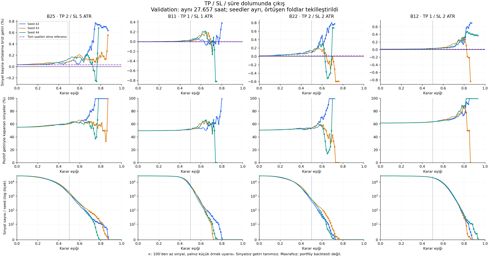
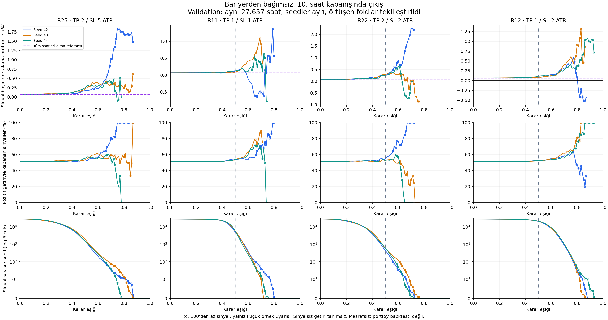

# Pozitif model sinyallerinin getirileri — 1/2 eklendi

23 Ekim 2026 · exp-022'nin kapsam genişletmesi · B25/B11/B22/B12.
Yeni eğitim veya final test yapılmadı. Mevcut A6 GRU validation tahminleri kullanıldı.

## Asıl istenen şeyi hesapladık mı?

**Evet. Filtre gerçek etiket değil, modelin ürettiği skordur.** Örneğin eşik
0,50 ise `model_skoru >= 0,50` olan bütün örnekler seçilir. Yalnız doğru
pozitifleri almak gibi sonucu yapay iyileştiren bir filtre uygulanmaz.
Seçilmiş örneklerdeki TP kazançları, SL kayıpları ve timeout getirileri
birlikte ortalamaya girer. Gerçekte etiket 0 olan yanlış pozitifler de dahildir.

Basit örnek: modelin seçtiği üç örnek +%1, −%2 ve +%0,4 getirirse ortalama
getiri −%0,2, kârla kapanma oranı %66,7 olur. Modelin pozitif sinyal vermesi
işlemin pozitif getirili olacağı anlamına gelmez.

İki ayrı getiri incelendi:

- **Bariyer çıkış getirisi:** sinyal mumunun kapanışından giriş; TP/SL
  temasında tam bariyer fiyatından, timeout'ta 10. saat kapanışından çıkış.
  Aynı mumda iki temas varsa eski kural korunur: SL önce.
- **10 saat kapanış getirisi:** arada TP/SL görülmesine bakmadan 10. saat
  kapanışı ile giriş kapanışı arasındaki getiri.

Buradaki “gerçekleşen”, gelecekteki fiyatların geçmiş veride gözlenmiş olmasıdır.
Gerçek emir gönderilmedi; emir gerçekleşmesi, gap, ücret, slippage ve funding
modellenmedi. Bu nedenle **geçmiş fiyatlardan hesaplanan brüt varsayımsal
sinyal getirisi** ifadesi daha doğrudur. Pozisyonlar çakışabilir; sonuçlar
portföy getirisi veya bağımsız işlemlerden oluşan bir backtest değildir.

## Aynı yöntemle dört bariyer, eşik 0,50

Her seed içinde aynı saat birden fazla fold'da varsa en yüksek fold numarası
tutuldu; seçim skora/getiriye göre yapılmadı. Her seed aynı 27.657 validation
saati kapsıyor. Önce seed içindeki sinyal ortalaması, sonra üç seed'in eşit
ortalaması alınıyor. Sinyal sayısı da seed başına ortalamadır.

| Bariyer | Sinyal / seed | Bariyer çıkış getirisi | Kârla kapanma | 10 saat kapanış getirisi |
|---|---:|---:|---:|---:|
| 2/5 | 1.647 | +%0,1022 | %60,81 | +%0,2104 |
| 1/1 | 5.620 | +%0,0216 | %51,66 | +%0,1025 |
| 2/2 | 537 | +%0,1046 | %53,23 | +%0,2596 |
| **1/2** | **20.716** | **+%0,0287** | **%63,55** | **+%0,0960** |

1/2, 0,50 eşikte saatlerin yaklaşık **%74,9'una sinyal** veriyor; bu eşikte
çok seçici değil. Kârla kapanma oranı diğerlerinden yüksek, fakat sinyal
başına getiri 2/5 ve 2/2'den düşük. Bariyerler farklı ödeme yapıları ve
farklı sinyal kümeleri ürettiğinden kazanma oranı tek başına kazanan belirlemez.

1/2'de model filtresi olmadan bütün saatleri alma referansı +%0,0126 bariyer
getirisi ve %61,66 kazanma oranıdır. 0,50 filtre sonrası +%0,0287 ve %63,55:
getiri katkısı yaklaşık **+0,0161 yüzde puan**, kazanma farkı **+1,89 yüzde puan**.
%63,55'in tamamını modelin becerisine atfetmemek gerekir.
TP'ye önce ulaşma oranı ise %58,21'dir; kârla kapanma %63,55 ile aynı ölçü değildir.

## 1/2 için eşik karşılaştırması

| Eşik | Sinyal / seed ortalaması (min–maks) | Bariyer getirisi | Kârla kapanma | 10 saat getirisi |
|---|---:|---:|---:|---:|
| 0,30 | 26.840 (26.779–26.947) | +%0,0168 | %62,11 | +%0,0717 |
| 0,40 | 25.490 (25.353–25.630) | +%0,0195 | %62,45 | +%0,0768 |
| 0,50 | 20.716 (20.389–20.933) | +%0,0287 | %63,55 | +%0,0960 |
| 0,60 | 8.378 (7.875–8.899) | +%0,0516 | %66,24 | +%0,1335 |
| 0,70 | 976 (880–1.030) | +%0,1055 | %69,65 | +%0,3372 |

Genel ortalamada daha yüksek eşik daha seçici ve daha yüksek getirili görünüyor.
Ancak **0,70'i seçmek için bu yeterli değil**; son dönemde aynı eşikte hiç
sinyal yok. Ham skor kalibre edilmiş olasılık değildir.

Her sütun bir bariyer, her renk bir seed. Üst sıra sinyal başına getiri,
orta sıra pozitif getiri oranı, alt sıra sinyal sayısı. Mor kesikli çizgi
tüm saatleri alma getiri referansı. × işareti 100'den az sinyali belirtir;
bu görsel bir uyarıdır, kabul kuralı değildir. Sıfır sinyalde getiri tanımsızdır.
Getiri panellerinin dikey ölçekleri farklıdır.

## 1/2'nin son dönem kontrolü

Son fold, eşik 0,50:

| Seed | Sinyal | Ortalama bariyer getirisi | Kârla kapanma |
|---|---:|---:|---:|
| 42 | 413 | −%0,0880 | %61,99 |
| 43 | 863 | −%0,1906 | %56,43 |
| 44 | 569 | −%0,1067 | %62,21 |

Üç seed de negatif ortalama üretiyor. Kazanma oranının %60 civarında olması
ekonomik başarı için yeterli değil; kayıp ve kazanç büyüklükleri de önemli.

Son fold'da 0,60 eşikte seed 42/43/44 için sırasıyla 41/91/69 sinyal ve
+%0,1657 / −%0,1919 / +%0,0553 ortalama bariyer getirisi var.
0,70 eşikte üç seed de **sıfır sinyal** üretiyor. Dolayısıyla bütün geçmiş
üzerindeki 976 sinyal/seed ortalaması son dönemde sinyal bulunacağını garanti etmez.

Eski toplulaştırma biçimiyle, her sinyalli fold/seed eşit ağırlıkta ele
alındığında 1/2'nin 114 grubunun hepsi sinyalli, 80'i pozitif ortalamalıdır;
ortalama bariyer getirisi +%0,0220. Bu, ana tablodaki tekilleştirilmiş
sinyal başına ortalamadan farklıdır ve ayrıca raporlanmıştır.

**Karar:** 1/2 karşılaştırmaya eklendi; genel ortalaması pozitif, son dönem
kararlılığı yeterli görünmüyor. Bir eşik veya bariyer seçilmedi. Validation
epoch seçiminde zaten kullanıldığı için bu sonuçlar bağımsız başarı kanıtı değildir.

## Dosyalar ve kontroller

- [Seçili eşikler](selected_thresholds.csv), [tüm eşikler](threshold_summary.csv),
  [seed ayrıntıları](seed_thresholds.csv), [yıl/seed ayrıntıları](year_seed_metrics.csv).
- [Son fold, 0,50](last_fold_threshold05.csv), [fold eşit ağırlık görünümü](fold_macro_threshold05.csv).
- [Plan](PLAN.md), [kod](analyze.py), [kaynak hashleri](input_manifest.json),
  [kontroller](checks.json), [çıktı hashleri](output_manifest.json).
- 4 × 114 = **456 validation dosyası** kontrol edildi. 1/2 dahil aynı zaman,
  etiket, getiri ve ortak model protokolü doğrulandı; 0,50 sinyal sayıları eski
  raporla eşleşti. Önceki üç adayın altı CSV çıktısındaki sayılar **birebir aynı**.
- Eski rapor korunuyor: [22 Ekim analizi](../barrier-economics-20261022/REPORT.md).
  Literatür incelemesi bu genişletmede değiştirilmedi.
