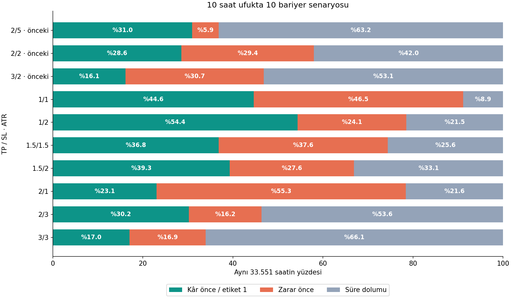
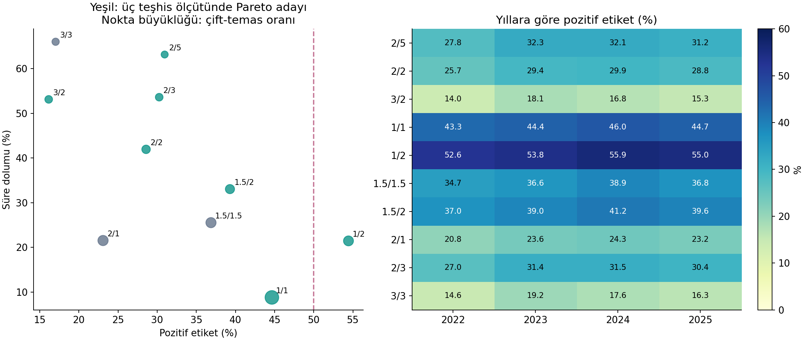

# 10 bariyer senaryosu: karşılaştırma ve aday seçimi

15 Ekim 2026 · exp-013-barrier-expansion · 7 yeni senaryo + 3 eski kontrol. Kullanıcı sınıf dengesi, süre dolumu ve getirinin birlikte değerlendirilmesini istedi.

## Karar

**Tek bir bilimsel kazanan belirlenmedi. Sonraki validation karşılaştırması için üç yeni aday: 1/1, 1/2 ve 1.5/2; tarihsel 2/5 kontrolü korunmalı.** Model eğitilmediği için hangi hedefin daha öğrenilebilir olduğunu, en iyi F1/AP veya net getiriyi sağlayacağını bu tablodan çıkaramayız.

- **1/1:** simetrik, pozitif oranı %44,62; en düşük timeout %8,87 ve yıllık pozitif oran %43,27–45,98. Etiket dengesi/temas netliği açısından güçlü aday. Buna karşılık 633 örnekte (%1,89) aynı mumda çift temas var; saatlik fiyatların sıralama belirsizliği en yüksek. Dar bariyerlerde maliyetlerin göreli etkisi ayrıca ölçülmeli.
- **1/2:** 50/50’ye en yakın oran (%54,39), timeout %21,50, çift temas %0,72. Ancak kâr mesafesi zarar mesafesinin yarısı; yüksek kâr-teması oranı tek başına ekonomik üstünlük değil.
- **1.5/2:** pozitif oran %39,29, timeout %33,08, çift temas %0,52. Daha büyük kâr hedefi ve daha az mum-içi belirsizlik için ara aday. Bu tercih açık bir ödünleşim yorumudur, ölçülmüş model üstünlüğü değildir.

1.5/1.5, 2/1 ve 3/3 sınıf dengesine uzaklık, timeout ve çift-temas üçlüsünde başka bir aday tarafından domine ediliyor; bu dar teşhis kriterlerinde kısa listenin dışında. Getiri hedefi farklıysa bunların genel olarak işe yaramaz olduğu söylenemez. 2/2 eşit TP/SL mesafesini 2 ATR büyüklüğünde korumak isteyenler için yardımcı kontrol olabilir.

## Tam karşılaştırma

Payda her senaryoda aynı 33.551 geliştirme saati (2022-03-01 04:00–2025-12-28 02:00 UTC). Ufuk 10 saat. Kâr önce = etiket 1; stop ve timeout = etiket 0.

| TP/SL ATR | Kâr önce | Zarar önce | Timeout | Çift temas* | TP/SL oranı |
|---|---:|---:|---:|---:|---:|
| 2/5 | 10,387 (%30.96) | 1,971 (%5.87) | 21,193 (%63.17) | 22 (%0.07) | 0.40 |
| 2/2 | 9,590 (%28.58) | 9,872 (%29.42) | 14,089 (%41.99) | 122 (%0.36) | 1.00 |
| 3/2 | 5,417 (%16.15) | 10,309 (%30.73) | 17,825 (%53.13) | 62 (%0.18) | 1.50 |
| 1/1 | 14,971 (%44.62) | 15,605 (%46.51) | 2,975 (%8.87) | 633 (%1.89) | 1.00 |
| 1/2 | 18,248 (%54.39) | 8,089 (%24.11) | 7,214 (%21.50) | 241 (%0.72) | 0.50 |
| 1.5/1.5 | 12,362 (%36.85) | 12,610 (%37.58) | 8,579 (%25.57) | 260 (%0.77) | 1.00 |
| 1.5/2 | 13,182 (%39.29) | 9,270 (%27.63) | 11,099 (%33.08) | 174 (%0.52) | 0.75 |
| 2/1 | 7,743 (%23.08) | 18,560 (%55.32) | 7,248 (%21.60) | 267 (%0.80) | 2.00 |
| 2/3 | 10,140 (%30.22) | 5,422 (%16.16) | 17,989 (%53.62) | 62 (%0.18) | 0.67 |
| 3/3 | 5,713 (%17.03) | 5,677 (%16.92) | 22,161 (%66.05) | 37 (%0.11) | 1.00 |

*Çift temas stop toplamının içindedir. Saatlik OHLC sıralamayı vermez; özgün zarar-önce kuralı korundu.

## Getiriyle ilişki

Bunlar etiket gruplarının **sabit 10 saatlik brüt kapanış getirileridir**; bariyerde kapatılmış bir stratejinin getirisi veya modelin seçtiği işlemler değildir. Pozitif etiket gelecekteki kâr temasını içerdiğinden yüksek koşullu getiri beklenen bir seçilim etkisidir; öğrenilebilirlik/alpha kanıtı değil.

| TP/SL | Etiket 1 ortalama getiri | Etiket 0 ortalama getiri | Timeout ortalama getiri | Pozitif getirili timeout |
|---|---:|---:|---:|---:|
| 2/5 | %1.342 | %-0.551 | %-0.339 | %37.692 |
| 2/2 | %1.376 | %-0.502 | %0.042 | %52.076 |
| 3/2 | %1.882 | %-0.321 | %0.230 | %59.843 |
| 1/1 | %0.758 | %-0.547 | %0.029 | %53.244 |
| 1/2 | %0.732 | %-0.796 | %-0.243 | %32.797 |
| 1.5/1.5 | %1.070 | %-0.569 | %0.030 | %51.801 |
| 1.5/2 | %1.063 | %-0.630 | %-0.087 | %44.725 |
| 2/1 | %1.411 | %-0.378 | %0.325 | %71.965 |
| 2/3 | %1.357 | %-0.538 | %-0.134 | %43.566 |
| 3/3 | %1.860 | %-0.339 | %0.052 | %51.482 |

3/2 ve 3/3 pozitif grubunda daha yüksek getiri var ama örneklerin yalnızca yaklaşık %16–17’si pozitif: daha büyük hedef daha nadir olay tanımlıyor. Bu sayıları tek başına maksimize etmek kullanıcı için daha iyi sınıflandırıcı seçmez. 2/1 timeout örneklerinin %71,96’sı pozitif getirdiği halde negatif etiketli; hedef ile basit getiri yönü farkı özellikle belirgin.

## Yıllık tutarlılık ve ödünleşimler

Yeşil noktalar 50/50’ye uzaklık, timeout ve çift-temas oranları birlikte azaltılırken domine edilmeyen adaylardır. Getiri bu mekanik Pareto filtresine katılmadı; etiket tanımının kendisinden türediği ve farklı hedefleri temsil ettiği için yukarıda ayrıca yorumlandı. Pareto kümesi geniş: 2/5, 2/2, 3/2, 1/1, 1/2, 1.5/2, 2/3. Bu yüzden yalnızca Pareto olmak “en iyi” sayılmak için yeterli değildir.

2022 ilk iki ayı, 2025 son günleri kapsam dışında; yıllık tablolar tam takvim yılları veya bağımsız test dönemleri değildir. Aynı saatlerin 10 saatlik hedefleri örtüşür. Güven aralığı veya istatistiksel anlamlılık iddia edilmedi. Masraf, funding, spread ve slippage değerlendirilmedi.

## Koruma ve tekrar üretim

- Ham ve hazırlanmış veri SHA256 ile doğrulandı. ATR/OHLC/10 saat getiri özgün tabloyla eşleşti.
- Eski 2/5, 2/2, 3/2 sayıları önceki raporla birebir eşleşti; mevcut 2/5 etiket/getirileri korundu.
- Ortak kapsamdan dışlanan örnek 0; model yükleme, eğitim ve Eylül 2026 test değerlendirmesi 0.
- [Sonuç öncesi plan](PLAN.md), [tüm metrikler CSV](results/barrier_comparison.csv), [yıllık CSV](results/barrier_by_year.csv), [girdi/ortam manifesti](results/manifest.json), [çıktı envanteri](results/output_manifest.json).
- Yeni satır etiketleri ayrı output/advisor_experiments/barrier-expansion-20261015 dizininde; eski tablolar değiştirilmedi.
- Script: scripts/analyze_advisor_barriers.py. Sonuçlar hesaplandıktan sonra aday listesi genişletilmedi.

**Sonraki adım önerisi:** 2/5 kontrolü ve bu üç adayı aynı özellik/mimari/validation takvimiyle karşılaştırmak. Her hedefin sınıf oranına uygun basit referansı ve validation içinde seçilen karar eşiği gerekir. Hedef değiştiği için ham AP/BCE/F1 değerleri tek başına aynı görevin iyileşmesi sayılmamalı. Bu eğitim bu çalışmanın kapsamında başlatılmadı.
