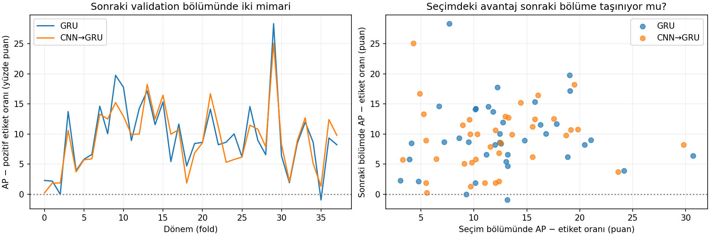

# Önceki sonuçların üzerine: seçimden sonraki döneme aktarım

31 Ekim2026 · exp-033 · Yeni eğitim yapılmadan exp032'nin eksik aktarım analizi.

## Tekrarlanmayan işler

Exp030'daki684 eğitim/37 özellik dağılımı analizi, eşik taramaları ve LR
karşılaştırmaları yeniden çalıştırılmadı. Exp031 AP checkpoint seçiminin
sonraki bölüme avantaj taşımadığını gösterdi. Exp032 incelemesindeki228-run
hash/epoch/tahmin doğrulaması korundu; aynı ZIP SHA256 kontrol edilerek
yalnız seçim–değerlendirme aktarımı ve yeni iki modelin ortak dönem davranışı
hesaplandı. Önceki raporlar:
[toplu teşhis](../comprehensive-diagnosis-20261028/REPORT.md),
[CNN sonuçları](../cnn-gru-20261031/REPORT.md).

## Yeni bulgular

| Ölçüt | GRU | CNN→GRU |
|---|---:|---:|
| Seçim bölümünde ortalama AP |0.43788|0.43149|
| Sonraki bölümde ortalama AP |0.40410|0.40078|
| Seçimde AP − pozitif oranı |0.12934|0.12295|
| Sonraki bölümde AP − pozitif oranı |0.09538|0.09207|
| Seçim/sonraki bölüm AP dönem korelasyonu |0.115|0.103|
| Seçim/sonraki bölüm AP−oran dönem korelasyonu |0.088|0.189|

Seçim ve sonraki bölümün genel pozitif oranları yakın: %30.855 ve%30.872.
Ancak dönemler içinde değişebilir. AP−oran sadece taban sıklığa göre
betimleyici farktır; tam sınıf-oranı düzeltmesi, anlamlılık testi veya yeni
model seçim ölçütü değildir. Korelasyonlar38 foldun üç-seed ortalamalarına
ait Spearman değerleridir; tek bir modelin geleceğini tahmin eden ölçüler
gibi yorumlanamaz. Seçim bölümü epoch seçiminde kullanıldığı için oradaki
AP zaten bağımsız ölçüm değildir; düşüş sadece piyasa değişimine bağlanamaz.

**İki mimarinin sonraki bölümdeki AP−oran değerlerinin dönem korelasyonu
0.876.** Genel performansları birbirine benzer dönemlerde yükselip düşüyor.
38 dönemin36'sında iki mimarinin de üç-seed ortalama AP'si taban pozitif
oranının üstünde; her ikisinin de altında olduğu dönem yok. Dolayısıyla
"modeller hiç öğrenmiyor" sonucu çıkmıyor. Seçici sinyal gücü ve aktarımı
sınırlı; aynı veriye dayanan iki mimari bağımsız neden kanıtı da değildir.

Solda benzer dönem hareketleri görülüyor. Sağda her nokta bir fold/üç-seed
ortalaması; seçim bölümünde büyük avantaj, sonraki bölümde aynı avantajı
garanti etmiyor. Bu grafik final test veya yeni eşik seçimi değildir.

## Eğitim eğrileri ne ekliyor?

İki mimarinin114'er çalışmasının tamamında, seçilen en iyi epoch ile son
epoch arasında train BCE düşerken seçim BCE yükseliyor. Medyan değişimler:
GRU train−0.1585/seçim+0.2529; CNN train−0.1582/seçim+0.2113.

**Seçim BCE'nin minimumdan sonra yükselmesi, minimum-BCE seçimi ve patience
kuralı nedeniyle tek başına yeni bir keşif değildir.** Ek gözlem train
kaybının aynı sürede düşmeye devam etmesidir. Bu örüntü aşırı uyumla
uyumludur, fakat aşırı kapasitenin kesin neden olduğunu kanıtlamaz.
Train BCE eğitim sırasında değişen ağırlıklar ve dropout açıkken ölçülür;
validation sabit epoch-sonu ağırlıklarla/dropout kapalı ölçülür. Bu nedenle
ikisinin mutlak farkını doğrudan genel performans farkı saymıyoruz.
Sonraki assessment için her epoch tahmini yok; değerlendirme kaybının epoch
boyunca ne zaman bozulduğunu bu arşivden söyleyemeyiz.

## Karar: sonraki tek kontrollü deney

LR küçültme, AP seçimi ve CNN ekleme tutarlı çözüm getirmedi; özelliklerin
tekil dağılım/etiket değişimleri de exp030'da genel neden olarak doğrulanmadı.
Bu işleri tekrarlamıyoruz. Açık kalan somut soru: **daha az model kapasitesi,
aynı bilgi ve aynı optimizasyonla sonraki dönem başarımını artırır mı?**

Öneri: mevcut A6 GRU hidden128 kontrolüne karşı yalnız **gru_hidden=64**.
GRU katman sayısı2, fusion_hidden128, dropout0.2, altı özellik, LR0.001,
veri/etiket/bölmeler, seedler, BCE seçimi ve eşikler aynı kalır. Katman sayısı,
dropout, özellik veya loss eşzamanlı değiştirilmez. Kontrolün yeniden üretimi
exp032'de114/114 tahminde birebir doğrulandı; yeni hazırlıkta koşul/kimlik
uyumu doğrulanarak mevcut kontrol kanıtı yeniden kullanılabilir.

Bu öneri henüz notebooka uygulanmadı veya eğitilmedi. Sonuç, kapasite
hipotezini sınar; başarı garantisi yok. Değerlendirme ortalama AP/BCE yanında
aynı önceden belirlenmiş eşiklerde precision, gerçekleşen sinyal kapsamı,
sinyalsiz run ve dönem/seed tutarlılığıyla yapılmalı. Final test açılmadı.

## Kontrol kapsamı

`analyze.py` yalnız önceki doğrulanmış ZIP'i okur;228 benzersiz kayıt,
aynı kaynak hash'i kontrol edilir. `by_run.csv`, `by_fold.csv`, `summary.json`
ve tek grafik üretildi. Yeni ham veri/özellik incelemesi, eğitim veya pytest
yok. Tarihsel validation yeniden kullanılıyor; foldlar/seedler bağımlı,
istatistiksel anlamlılık veya kesin nedensellik iddiası yok.
