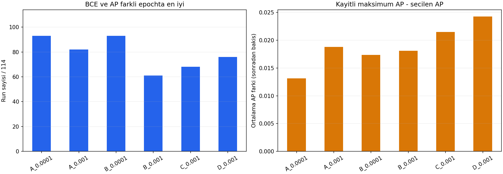
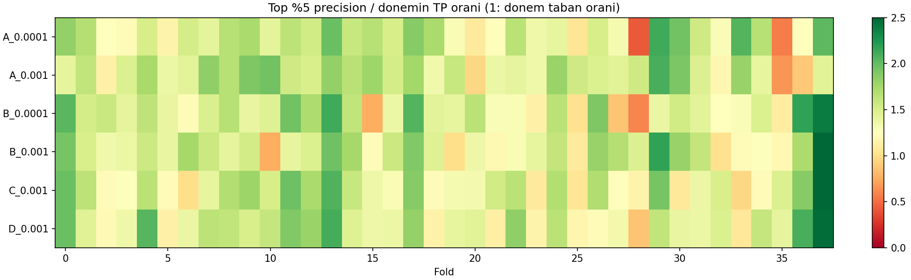

# Mevcut karşılaştırılabilir eğitimlerin toplu teşhisi

28–29 Ekim 2026 · 6 koşul × 38 fold × 3 seed = **684 tamamlanmış eğitim**.
exp-030; önceki A6 eşik ve dönem incelemelerinin genişletilmiş devamı.

**Ana sonuç:** Modellerde sıralama bilgisi var, fakat en yüksek skorlu
örnekleri seçmede koşullar arası ortalama fark küçük; dönem farkı büyük.
BCE/AP epoch ayrışması yaygın. Düşük öğrenme hızı kısmi iyileştirme sağlıyor,
ancak seçici sinyal ve dönem kararlılığı sorununu tek başına çözmüyor.

## Kapsam ve yöntem

- A: 6 özellik GRU; B: 37 özellik GRU; C: 37 özellik TCN; D: 37 özellik
  TCN+GRU. Orijinal dört koşul LR0.001; A ve B için ek LR0.0001 sonuçları.
- Aynı dondurulmuş veri, 2/5 ATR, 10 bar, aynı 38 fold ve seed42/43/44.
  Başka bariyerler farklı hedefler olduğu için bu sıralamaya karıştırılmadı.
- Bütün mevcut epoch geçmişleri ve seçilen checkpointlerin validation
  tahminleri incelendi: 695.628 tahmin kaydı. Bunlar örtüşen fold ve tekrarlanan
  seed/model tahminleridir; bağımsız gözlem veya işlem sayısı değildir.
- BCE/AP ve epoch farkları eşit ağırlıklı run ortalamaları. Eşik tabloları
  TP/FP/FN toplamları. Top-%5: her run'da en yüksek skorlu 51/1017 örnek;
  geçmişe dönük sıralama teşhisi, uygulanmış yeni sinyal kuralı değil.
- Eşikler 0.30–0.70, adım0.05; top oranları %1/%2/%5/%10/%20. Her fold,
  her seed ve kronolojik dört blok raporlandı. Sonuçlara göre dönem atılmadı.
- Dönem bağlamı olarak önceki çalışmanın mevcut altı temel özellik dağılımı,
  tekil etiket ilişkileri ve train–validation TP oranı farkı kullanıldı.
  Ek olarak 37 girdinin tamamı 38 fold boyunca incelendi: 1.406 özellik–fold
  çifti. model_input_correlations.csv A için altı, B/C/D için mevcut 37
  girdinin tanımlı ölçülerini kullanır; ortak-altılı sonuçlar ayrıca korundu.
- Yeni eğitim, final test, kalibrasyon, ensemble, özellik veya seçim kuralı yok.

## 1. Ortalamada ne kadar fark var?

| Koşul | BCE ↓ | AP ↑ | Top-%5 precision | 0.5'te sinyalsiz run |
|---|---:|---:|---:|---:|
| A6, LR0.001 | 0.59433 | 0.42121 | %47.32 | 14/114 |
| A6, LR0.0001 | 0.59455 | 0.41987 | %46.25 | 35/114 |
| B37, LR0.001 | 0.60947 | 0.40493 | %46.65 | 1/114 |
| B37, LR0.0001 | 0.60115 | 0.41026 | %46.23 | 23/114 |
| C37, LR0.001 | 0.60291 | 0.40959 | %46.34 | 5/114 |
| D37, LR0.001 | 0.60167 | 0.41148 | %46.84 | 18/114 |

En iyi ve en düşük top-%5 precision arasındaki fark yaklaşık 1.09 yüzde
puan. Bu tabloda yeni mimarinin veya 37 girdinin belirgin bir seçicilik
üstünlüğü yok. Farkların istatistiksel anlamlılığı iddia edilmiyor.
Genel TP oranı %31.05; top-%5 sonuçları bundan yüksek. Yani "hiç bilgi yok"
yorumu da doğru değil. Her dönemde aynı güçte bilgi elde edilemiyor.

B37'de LR düşüşü BCE'yi 0.00832, AP'yi 0.00533 iyileştirmiş; eşit top-%5
precision ise %46.65'ten %46.23'e düşmüş. A6'da BCE/AP ortalaması da
iyileşmemiş. **Ortalama kayıp/sıralama ölçütündeki kazanç, seçilen küçük
gruptaki precision kazancıyla eş anlamlı değil.**

0.5 eşiğinde precision/recall: A eski %48.74/%9.19, A yeni %48.56/%7.11;
B eski %44.74/%14.06, B yeni %46.35/%9.41. Farklı sinyal sayıları nedeniyle
yalnız precision karşılaştırması yeni LR'yi gereğinden iyi gösterebilir.
Bütün eşik sonuçları threshold_summary.csv; eşit kapsam topk_summary.csv.

## 2. BCE ve AP ne sıklıkla farklı epoch istiyor?

| Koşul | Farklı epoch /114 | AP tepesi daha geç | AP tepesi daha erken | Ortalama AP farkı |
|---|---:|---:|---:|---:|
| A6, LR0.001 | 82 | 58 | 24 | 0.0188 |
| A6, LR0.0001 | 93 | 49 | 44 | 0.0132 |
| B37, LR0.001 | 61 | 59 | 2 | 0.0181 |
| B37, LR0.0001 | 93 | 63 | 30 | 0.0174 |
| C37, LR0.001 | 68 | 62 | 6 | 0.0215 |
| D37, LR0.001 | 76 | 69 | 7 | 0.0243 |

Toplam **473/684** eğitimde iki ölçütün optimum epochu farklı.
Fakat bu sayı tek başına farkın büyük olduğunu söylemez. Örneğin düşük
LR A6'da 93 ayrışmanın yalnızca 42'sinde AP farkı0.01'den büyük; medyan
fark0.0047. Ayrışma sayısı artarken farkın büyüklüğü azalabiliyor.

Kaydedilen AP maksimumunda BCE maliyeti, orijinal C/D'de ortalama
0.1218/0.1101; düşük LR A6'da 0.0050. Dolayısıyla AP'yi yükseltmek bazı
koşullarda kaybı ciddi kötüleştiriyor. Bir hedefi iyileştirirken diğerini
göz ardı etmemeliyiz.

**Bu tablo bir AP-seçimli deney sonucu değildir.** Aynı validation'a
sonradan bakılan maksimum zaten yukarı yanlıdır. Üstelik eğitimler BCE
patience ile durduruldu; AP ile erken durdurulsaydı geçmiş farklı olabilirdi.
Alternatif epochların tahminleri/ağırlıkları review ZIP'lerinde bulunmuyor;
bu yüzden onların top-%5 precision'ı veya bağımsız başarımı bilinmiyor.
Yeni seçim kuralı uygulanmadı.

## 3. Seed mi, dönem mi?

Hücre = top-%5 precision / o dönemin TP oranı; üç seed ortalaması.
1, dönemin taban oranı; 1.5, seçilen örneklerde TP oranının tabanın 1.5 katı
olmasıdır. Yeşil daha iyi zenginleştirme; kırmızı tabanın altıdır. Sütunlar
bütün 38 foldu gösterir; seçilmiş başarılı dönemler değildir.

| Koşul | Aynı fold'da seed precision aralığı medyanı | Fold ortalamalarının min–max'ı |
|---|---:|---:|
| A6, LR0.001 | 11.76 puan | %18.30–67.32 |
| A6, LR0.0001 | 5.88 puan | %10.46–68.63 |
| B37, LR0.001 | 12.75 puan | %22.22–67.32 |
| B37, LR0.0001 | 9.80 puan | %15.03–73.20 |
| C37, LR0.001 | 9.80 puan | %28.76–71.24 |
| D37, LR0.001 | 13.73 puan | %21.57–72.55 |

Seed farkı azalırken kötü dönem ortadan kalkmıyor. Seed aralığı medyanı
ile dönem min–max farklı özetlerdir; bu tablo bir varyans ayrıştırması değildir.
Ama her koşulun geniş dönem değişkenliğini açıkça gösterir.

Altı koşul ortalamasında en düşük top-%5 precision fold28 (%25.16) ve
fold35 (%29.74). Dolayısıyla problem yalnız A6'nın tek seed'i değil; bazı
dönemler birçok koşul için zor. Modeller aynı düzeyde kötü olmak zorunda
değil; tüm fold/koşul sonuçları fold_summary.csv'de.

## 4. Önceki neden hipotezleri bütün veride destekleniyor mu?

**Volatilite–etiket ilişkisinin değişimi:** Fold28 için anlamlı bir ipucuydu.
Fakat altı temel özellikteki ortalama mutlak ilişki değişimi ile top-%5
lift arasındaki 38-fold korelasyonu, düşük LR A6'da −0.157; eski A6'da
0.001. Diğer koşullarda −0.060 ile +0.208 arasında. **Bunu genel neden
olarak doğrulayamadık.** Önceki iki-dönem gözlemini tüm verilere genellemek
yanlış olurdu. Çok değişkenli/zamansal ilişki değişimleri hâlâ açık.

Marjinal özellik dağılımı uzaklığı da başarıyla tutarlı ters ilişki
göstermiyor. Bu nedenle "dağılım farklıysa işlem yapma" filtresi veya
otomatik özellik çıkarma kuralı üretilmedi. Hiçbir p-değeri veya nedensellik
iddiası yok; foldlar örtüşüyor ve analiz keşifsel.

**37 girdiye genişletince:** B/C/D'de kendi girdilerinin ortalama etiket-ilişkisi
değişimi ile top-%5 lift korelasyonları sırasıyla B yeni +0.017, B eski
−0.099, C −0.092, D −0.004. Tutarlı güçlü açıklama burada da bulunmadı.
Marjinal ortalamalar, çok değişkenli ilişkileri veya 64 barlık dizilerin
yapısını temsil etmez; bu analiz özelliklerin faydasızlığını kanıtlamaz.

**Yeni somut bulgu: dört whale bayrağı çok seyrek.** Aşağıdakiler 38
validation penceresindeki satır oranlarının ortalaması ve sabit pencere sayısıdır:

| Girdi | Ortalama aktif satır oranı | Sabit validation penceresi /38 |
|---|---:|---:|
| whale_buy_flag | %0.66 | 1 |
| whale_sell_flag | %0.70 | 1 |
| 4h_whale_buy_flag | %0.12 | 29 |
| 4h_whale_sell_flag | %0.20 | 24 |

Özellikle 4 saatlik bayraklar birçok dönemde örnekleri birbirinden ayıracak
değişkenlik taşımıyor. Bu bir üretim hatası veya çıkarılmaları gerektiği
kanıtı değil; seyrek olayları temsil ediyor olabilirler. Train IQR dört
bayrakta bütün foldlarda sıfır: normalize uzaklık bu 152 çiftte tanımsız
bırakıldı. Değer uydurulmadı; aktiflik oranı ayrıca raporlandı. 63 çiftte
sabit girdi penceresi nedeniyle etiket korelasyonu da tanımsız.
Ortalama uzaklık 33 tanımlı girdiden, ortalama ilişki değişimi o foldun
tanımlı girdilerinden hesaplandı. Dosyalarda bu eksikler açıkça korunuyor.

**Zaman blokları:** LR düşürme etkisi sabit değil. B37 AP'si ilk10 fold,
ikinci10 ve son8 fold bloklarında yükselirken 20–29'da 0.407'den 0.395'e
düşüyor. A6'da 20–29 düşüşü 0.421→0.408; son8 fold ise 0.394→0.407
iyileşiyor. Sadece son döneme veya bütün dönemlerin tek ortalamasına bakmak
bu karşıt etkileri gizler.

**Örtüşme duyarlılığı:** Çift ve tek foldlar ayrı özetlendi; her grubun
validation pencereleri kendi içinde örtüşmez (60 gün adım,45 gün pencere).
Train pencereleri/seedler bağımlı kalır; bu bağımsız test değildir.
A6 düşük LR'nin ortalama AP üstünlüğü bu iki grupta da tutarlı değil.
B37 düşük LR'nin BCE kazanımı iki grupta da görülüyor, AP kazanımı ise
çift foldlarda var, tek foldlarda yok. Sonuç tek bir toplulaştırmaya dayanmadı.

## Araştırma kararı

Mevcut kanıtları kullanarak şu soruları tamamladık: farklı eşikler,
eşit sinyal kapsamı, bütün seed/foldlar, kronolojik bloklar, örtüşmeyen
validation alt grupları, BCE/AP epoch ayrışması, sabit train-oranı BCE
referansı ve mevcut 37 girdinin dağılım/etiket ilişkisi üzerinden dönem bağlamı.

1. Eski A6 makul referans; üstünlüğü küçük ve her dönemde geçerli değil.
2. Düşük LR kararlılığa kısmen yardımcı; seçici precision sorununu çözmedi.
3. Epoch seçimi araştırılmaya değer ama AP'ye geçmenin çözüm olduğu kanıtlanmadı.
4. Yeni mimari aramasından önce seçim hedefiyle değerlendirme hedefini
   eşleştiren kontrollü deney daha gerekçeli. Bunun için kayıtlı maksimum
   AP'yi yeni başarı diye ilan etmek yerine, koşulları önceden sabitlenmiş
   bir doğrulama tasarımı gerekir.
5. Bu soruda arşivlerin bir sınırına geldik: alternatif epochlar için örnek bazında
   tahmin olmadan precision/kararlılık sonucunu tamamlayamayız. Eğitim
   bütçesi harcamadan bu kapsamda planlanan teşhisler tamamlandı; yeni eğitim ya da
   checkpoint kuralı bu raporla sessizce etkinleştirilmedi.

## Tekrarlanabilirlik ve kontroller

Depo kökünden `python research/analyses/comprehensive-diagnosis-20261028/analyze.py`.
37-girdi eki için aynı klasördeki `feature_context.py` çalıştırılır.
Kaynak ZIP SHA256'ları checks.json'da. 684 benzersiz model/seed/fold,
aynı validation tarih/etiket/konumları, min-BCE epochu ve tahminlerden AP
doğrulandı. Veri/bölme ayrıntıları önceki exp029 denetimine bağlı.
Top-k sınırında tek eşit skor bulundu (C,seed42,fold32,%20); aynı etiket
olduğu için olası precision alt/üst sınırları aynı. Sabit satır sırası
kullanıldı; etiketle bağ çözülmedi. Kontrol bu durumu yakaladıktan sonra
açık eşitlik sayımı ve sınırları eklendi; analiz başarıyla tekrar tamamlandı.

İki grafik görsel olarak incelendi. Yeni eğitim veya tam test paketi
çalıştırılmadı. Raw veri, modeller ve ZIP Git dışında. Validation birçok kez
incelendiği için tüm sonuçlar keşifsel; ekonomik kârlılık, istatistiksel
anlamlılık veya bağımsız test başarımı iddiası yok. Tarihsel 34-girdili ve
farklı bariyerli deneyler ayrı sorular/etiketler oldukları için birleştirilmedi.

Ana 684-run hesapları bağımsız Sol/medium incelemesinde doğrulandı (PASS).
Sonradan eklenen 37-girdi ekinin bağımsız incelemesi kullanım limitine takıldı;
bu ek için PASS iddiası yok. Yerel kapsam kontrolünde altı ortak girdinin
önceki hesaplarla eşleşmesi ve seyrek girdilerin oran/sabitlik kayıtları doğrulandı.
