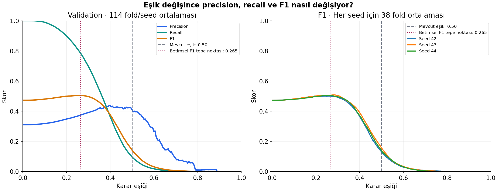
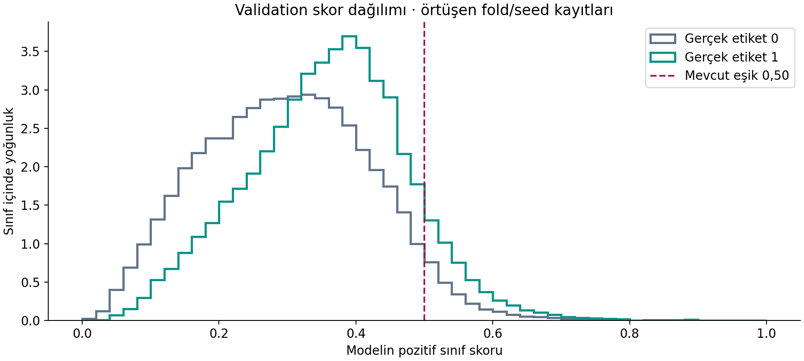
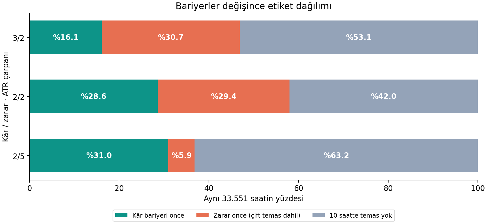
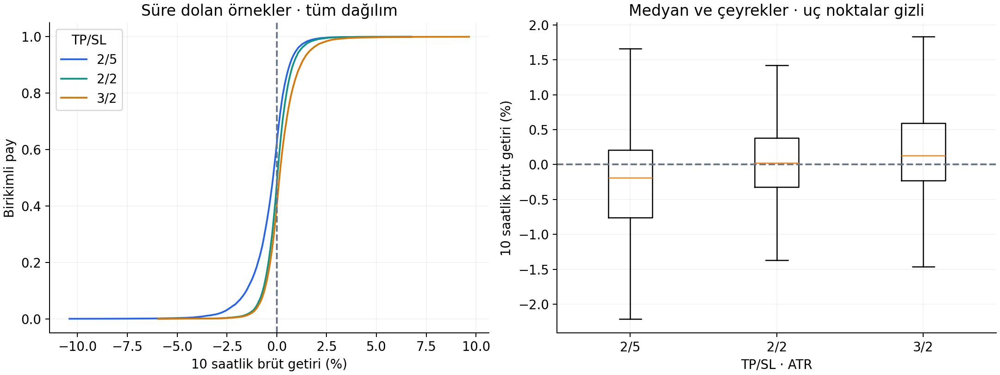

# Düşük recall/F1: eşik ve bariyer teşhisi

15 Ekim 2026 · A/6 özellik/GRU/BCE · yeni eğitim veya test değerlendirmesi yok.

## 1. Eşik davranışı

0,50 eşiğinde model yalnızca %6,29 oranında pozitif karar veriyor; 114 fold/seed grubunun 14’ünde hiç pozitif karar yok. Pozitif örneklerin ortalama skoru 0,358, negatiflerin 0,299. Skorlar sınıfları kısmen sıralıyor fakat büyük ölçüde örtüşüyor; pozitiflerin çoğu 0,50’nin altında kalıyor. Bu, AP/BCE iyileşmesiyle düşük recall/F1’in aynı anda görülmesini açıklıyor. Tek başına kalibrasyon hatası veya bütün sorunun eşik olduğu kanıtlanmış değildir.

| Eşik | Precision | Recall | F1 | Pozitif karar oranı |
|---|---:|---:|---:|---:|
| 0.2 | %34.81 | %89.96 | %49.95 | %80.77 |
| 0.265 | %37.49 | %78.37 | %50.39 | %65.45 |
| 0.3 | %39.14 | %69.79 | %49.73 | %55.92 |
| 0.4 | %43.66 | %36.46 | %37.63 | %26.17 |
| 0.5 | %41.05 | %9.68 | %14.24 | %6.29 |

38 fold × 3 seed için metriklerin eşit ağırlıklı ortalaması. F1, ortalama precision/recall’dan yeniden hesaplanmadı.

**0,265**, incelenen 201 eşikte en yüksek ortalama validation F1 noktasını veriyor: 0,5039. Recall %78,37’ye çıkarken precision %37,49’a düşüyor ve örneklerin %65,45’i pozitif ilan ediliyor. Eşiği düşürmek daha iyi bir model üretmez; hata türlerinin dengesini değiştirir. F1 eğrisi tepe çevresinde geniş/yatık; bu üç ondalıklı değer evrensel optimum değildir.

Bu eşik yalnızca betimsel validation bulgusudur; canlı kullanım eşiği olarak benimsenmedi. Model/epoch da aynı validation üzerinde seçildiğinden bağımsız performans tahmini değildir. Eylül 2026’da denenmedi. Her şeyi pozitif sayan eşik 0 referansı da CSV’de bulunur; F1 tek başına yeterli değildir.

115.938 tahmin kaydı, örtüşen foldlar ve üç seed nedeniyle yalnızca 27.657 benzersiz validation saatini temsil ediyor (2022-09-30 19:00–2025-11-26 03:00 UTC). Bu kayıtlar bağımsız 115.938 gözlem değildir. Pooled tablolar yardımcıdır; ana sonuç fold/seed ortalamasıdır.

## 2. Bariyerler etiket dağılımını nasıl değiştiriyor?

Aynı 33.551 geliştirme saati, 10 saat ufuk; TP/SL ATR çarpanları. Kâr önce = etiket 1; zarar önce ve süre dolumu = etiket 0.

| TP/SL | Kâr önce | Zarar önce | Süre dolumu | Aynı mumda çift temas* |
|---|---:|---:|---:|---:|
| 2/5 | 10,387 (%30.96) | 1,971 (%5.87) | 21,193 (%63.17) | 22 |
| 2/2 | 9,590 (%28.58) | 9,872 (%29.42) | 14,089 (%41.99) | 122 |
| 3/2 | 5,417 (%16.15) | 10,309 (%30.73) | 17,825 (%53.13) | 62 |

*Çift temas zarar-önce toplamına dahildir; saatlik OHLC gerçek temas sırasını çözemez. Mevcut motorun ihtiyatlı kuralı korundu.

2/5 düzeninde baskın durum zarar bariyeri değil, **süre dolumu (%63,17)**. Stop mesafesini 5 ATR’den 2 ATR’ye daraltmak stop temasını artırıyor; 2/2’de pozitif etiket oranı %30,96’dan %28,58’e düşüyor. 3/2’de pozitif etiket oranı %16,15’e iniyor. Dolayısıyla daha simetrik bariyer otomatik olarak daha dengeli ikili sınıf veya daha iyi F1 anlamına gelmiyor.

## 3. Süre dolan örneklerin getirileri

| TP/SL | Ortalama getiri | Medyan | %5–%95 aralığı | Pozitif getirili timeout |
|---|---:|---:|---:|---:|
| 2/5 | %-0.339 | %-0.188 | %-2.105 / %0.966 | %37.69 |
| 2/2 | %0.042 | %0.024 | %-0.981 / %1.146 | %52.08 |
| 3/2 | %0.230 | %0.131 | %-0.905 / %1.659 | %59.84 |

2/5’te süre dolanların %37,69’u, 3/2’de %59,84’ü pozitif getiri taşıdığı halde etiketleri 0. Mevcut hedef “10 saatte getiri pozitif mi?” değil, “önce kâr bariyerine ulaştı mı?” sorusudur. Negatif sınıf bu nedenle zarar edenlerle yeterli yükselişi gerçekleştiremeyenleri birlikte içeriyor. Her bariyerin timeout altkümesi farklıdır; ortalamalar aynı işlemlerin getirisi gibi karşılaştırılmamalıdır. Bunlar masraf, funding ve slippage içermeyen brüt kapanış getirileri; strateji kârlılığı sonucu değildir.

## Doğrulama ve kayıt

- 114 tahmin dosyası ve protokol/özet özgün review manifestine karşı SHA256 ile doğrulandı.
- Hazırlanmış tablo ve ham 1h verisi özgün hashlerle eşleşti; hiçbir giriş değiştirilmedi.
- Mevcut 0,50 metrikleri eski raporla; ATR, 2/5 etiketleri, temas türleri ve getiriler özgün tabloyla eşleşti.
- Üç bariyerde aynı 33.551 timestamp; kapsam içinden dışlanan örnek 0. Son 10 saatlik hedef için ham snapshot uzantısı kullanıldı.
- Kaynak plan: [PLAN.md](PLAN.md). CSV ve grafikler results altında; ayrıntılı satır/fold çıktıları output/advisor_experiments/diagnostics-20261015 altında.
- Hesaplama tamamlandıktan sonra çıktı envanteri yazımında göreli/absolute yol hatası oluştu. Hesaplama çıktıları korundu; yalnızca envanter adımı düzeltildi ve tamamlandı. Aynı analiz tekrar çalıştırılmadı. Çalıştırılan özgün script kopyası ve hash’i ayrıntılı çıktı alanında saklandı.
- [Girdi manifesti](results/input_manifest.json), [çıktı manifesti](results/output_manifest.json), [özet](results/summary.json).

**Karar:** Önce yeni mimari denemek yerine karar eşiği ile hedef tanımını ayrı sorular olarak ele almak gerekçelendirildi. Yeni eşik veya bariyer üretim ayarı olarak seçilmedi. Yeni performans iddiası için önceden dondurulmuş seçim kuralı ve yeni dokunulmamış değerlendirme gerekir.
