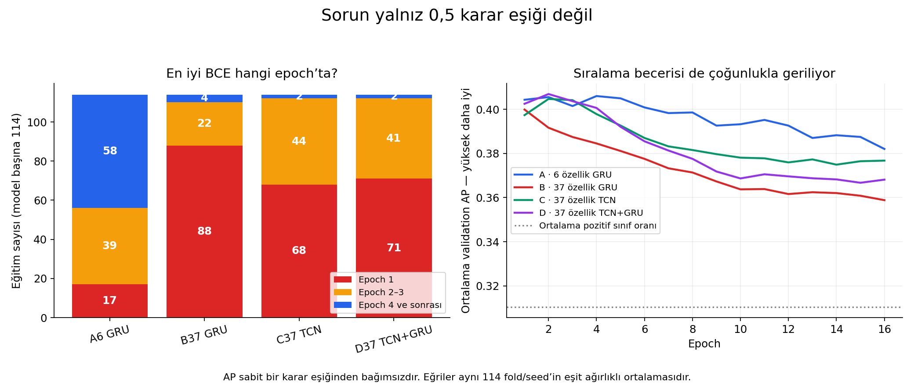
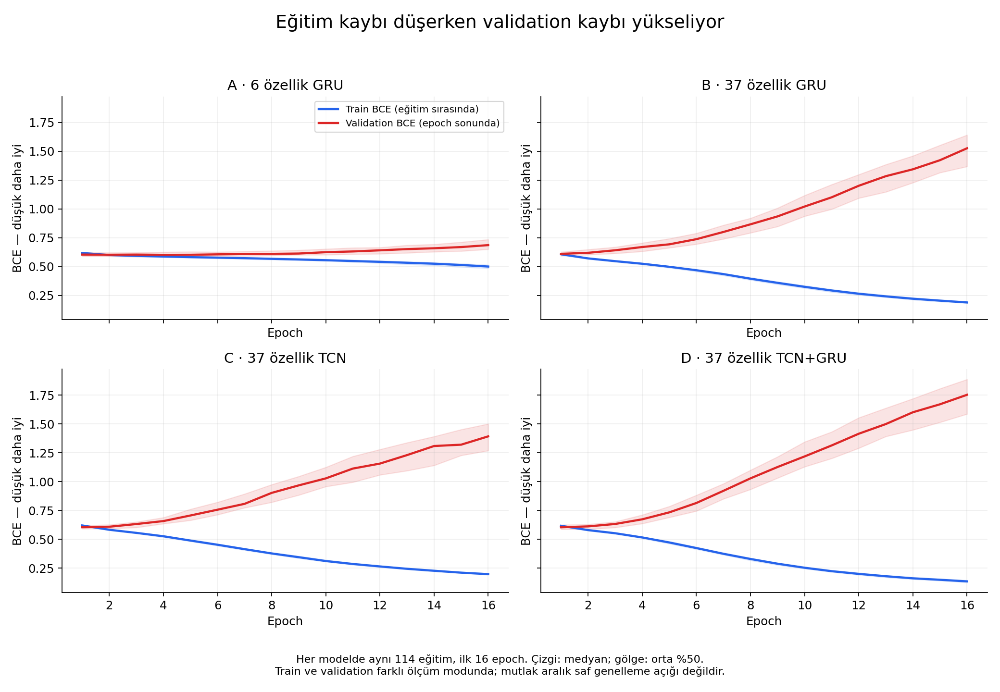
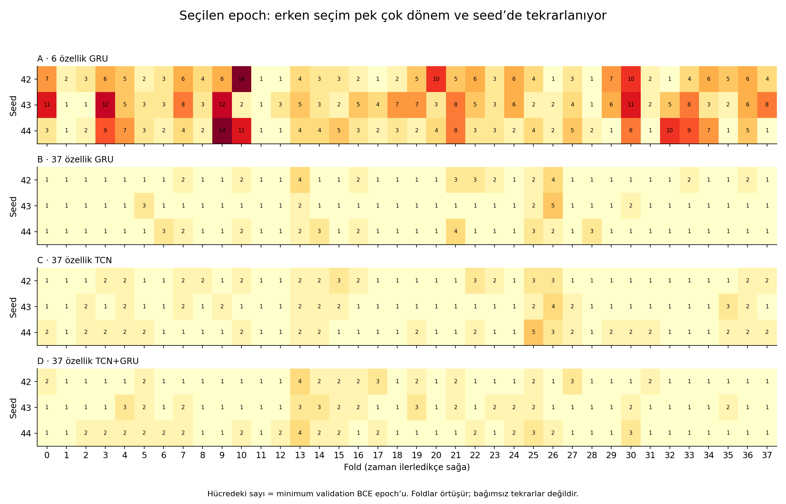

# En iyi epoch neden erken? — 24 Ekim 2026

**Ana bulgu:** 37 özellikli modeller eğitim verisine hızla uyum sağlarken bu
iyileşme validation'a taşınmıyor. Eğitim ilerledikçe validation BCE ve çoğu
eğitimde AP kötüleşiyor. Bu, aşırı öğrenmeyle güçlü biçimde uyumlu. Ancak bunun
hangi özellikten, öğrenme hızından veya dönem değişiminden ne kadar
kaynaklandığını bu kayıtlar tek başına ayıramaz. Çözüm henüz doğrulanmış değil.

İncelenen çalışma: **A6/B37/C37/D37, exp-021**, 2/5 ATR, 10 saat, 38 fold,
seed 42/43/44. Bu rapor altı bariyer deneyinin eğrileriyle karıştırılmamalı.
Kaynak [Drive review ZIP](https://drive.google.com/file/d/1ORArzDL8n6T6jt_ssGekJhbnVvXnMrQI/view).
456 history.csv dosyasının tamamı mevcut. Yeni eğitim veya test yapılmadı.

## 1. Erken seçim ne kadar yaygın?

| Model | Ortalama en iyi epoch | Medyan | İlk epoch seçilen | İlk 3 epoch içinde seçilen | Gerçekte eğitilen epoch aralığı |
|---|---:|---:|---:|---:|---:|
| A: 6 özellik GRU | 4,44 | 4 | 17/114 | 56/114 (%49,1) | 16–29 |
| B: 37 özellik GRU | 1,37 | 1 | 88/114 | 110/114 (%96,5) | 16–20 |
| C: 37 özellik TCN | 1,50 | 1 | 68/114 | 112/114 (%98,2) | 16–20 |
| D: 37 özellik TCN+GRU | 1,48 | 1 | 71/114 | 112/114 (%98,2) | 16–19 |

**Eğitim ilk epoch'ta durmamış.** En iyi BCE'den sonra 15 epoch daha iyileşme
beklenmiş; ardından o en iyi epoch'un ağırlıklarına dönülmüş. Kayıtlardaki
seçim ve durdurma sayıları 456 eğitimin tamamında bu kuralla uyumlu.
Örneğin en iyi epoch 1 ise eğitim 16 epoch sürüyor. 4977 dizi ve 256 batch
boyutuyla bir epoch yaklaşık 20 ağırlık güncellemesi içeriyor; ilk epoch
eğitimsiz model demek değil. Epoch 0 ölçümü bulunmuyor.

## 2. Sonraki epoch'larda ne oluyor?

Farklı uzunluktaki eğitimleri karıştırmamak için aşağıdaki karşılaştırma
**her modelin aynı 114 eğitiminin ilk ve 16. epoch'u** üzerinden yapıldı.
Tablodaki değerler eşit fold/seed ağırlıklı ortalamadır.

| Model | Train BCE: 1 → 16 | Validation BCE: 1 → 16 | Validation AP: 1 → 16 |
|---|---:|---:|---:|
| A | 0,616 → 0,499 | 0,609 → 0,700 | 0,404 → 0,382 |
| B | 0,607 → 0,191 | 0,612 → 1,503 | 0,400 → 0,359 |
| C | 0,620 → 0,200 | 0,608 → 1,392 | 0,397 → 0,377 |
| D | 0,617 → 0,137 | 0,608 → 1,744 | 0,402 → 0,368 |

Train BCE düşerken validation BCE yükselmesi A'da 111/114, diğer üçünde
114/114 eğitimde görülüyor. AP düşüşü sırasıyla 80, 88, 74 ve 82 eğitimde
var. Yani az sayıdaki kötü eğitim ortalamayı tek başına bozmuyor.

Grafikte mavi aşağı inerken kırmızının yukarı çıkması şu anlama geliyor:
model eğitim döneminin cevaplarını daha iyi öğreniyor, sonraki döneme
uygulandığında ise tahmin kalitesi geriliyor. AP düşüşü, pozitif örnekleri
üst sıralara taşıma becerisinin de çoğu eğitimde zayıfladığını gösteriyor.
**Yalnızca karar eşiğini değiştirmek bu bozulmayı gidermez.**

Train BCE güncellemeler sırasında ve dropout açıkken; validation BCE
epoch sonunda, dropout kapalıyken ölçülüyor. Bu nedenle aralarındaki mutlak
farkı saf genelleme açığı diye yorumlamıyoruz. İki serinin kendi içindeki
ters yönlü hareketi ve validation AP düşüşü teşhisin temel dayanakları.
Grafikte medyan ve orta %50 aralığı var; tablo ortalama olduğu için çizgi
ile sayılar birebir aynı olmak zorunda değil.

## 3. Neden olabilir; neyi söyleyemeyiz?

| Açıklama | Kanıtın durumu |
|---|---|
| Eğitim dönemine aşırı uyum | Güçlü gözlemsel destek: train iyileşirken validation BCE/AP bozuluyor. |
| 6 → 37 girdinin mevcut düzende öğrenmeyi daha kırılgan hale getirmesi | Aynı GRU ailesinde A/B farkı bunu destekliyor. Hangi özellik veya etkileşim sorumlu bilinmiyor; B'nin parametre sayısı da biraz artıyor. |
| Yalnızca çok büyük model kullanılması | Yetersiz açıklama. C, 68.225 parametreyle A'nın 168.193 parametresinden küçük olmasına rağmen hızlı bozuluyor. B: 180.097, D: 248.065. |
| Öğrenme hızının fazla olması | Olası, kanıtlanmadı. Hepsinde AdamW ve sabit 0,001 var; alternatif hız denenmedi. Train kaybının düzenli düşmesi tek başına optimizasyonun validation için uygun olduğunu göstermez. |
| Dönem/dağılım değişimi | Olası katkı. Foldlar arasında başarı ve sınıf oranı değişiyor. Fakat ham özelliklerin train/validation dağılımı bu raporda ölçülmedi; nedensellik kurulamaz. |
| Yalnızca kötü seed | Bulgularla uyuşmuyor. Her üç seed'in ortalamalarında aynı bozulma var; daha fazla seed ortalaması temel sorunu ortadan kaldırmaz. |
| Sadece yanlış 0,5 eşiği | Yetersiz açıklama. BCE ve AP bu karar eşiğinden bağımsız; onlar da bozuluyor. |
| Epoch seçim/durdurma hatası | İncelenen kayıt ve motor kodunda buna ilişkin bulgu yok. Bütün altyapının hatasız olduğu anlamına gelmez. |

Her fold'da 4977 eğitim dizisi var ama bunlar bağımsız 4977 piyasa olayı
değil: komşu 64 barlık diziler 63 barı paylaşıyor; 10 saatlik hedef ufukları
da örtüşüyor. Bu, veri miktarını yorumlarken önemli. Buradan etkin bağımsız
örnek sayısını hesaplamış değiliz; pencereyi/veriyi değiştirmedik.

## 4. Seed ve dönem değişince ne oluyor?

B/C/D'de erken seçim yalnız son fold'da değil, birçok dönemde tekrarlanıyor.
A'nın ortalama en iyi epoch'u seedlere göre 4,32 / 4,82 / 4,18;
B'ninki 1,45 / 1,24 / 1,42. C ve D de üç seed'de yaklaşık 1,4–1,6.

Aynı fold içindeki üç seed'in seçilmiş BCE farkının medyanı A/B/C/D için
0,0072 / 0,0130 / 0,0103 / 0,0093. Buna karşılık fold ortalamaları A'da
0,536–0,680, B'de 0,551–0,702 aralığında. Bu iki betimsel özet bir varyans
ayrıştırması değildir; seed etkisiyle dönem etkisinin farklı şeyler olduğunu
gösterir. Validation pozitif sınıf oranı da %24,1–%40,4 arasında değiştiği
için dönemler arası ham BCE/AP farkını yalnız modelin becerisine bağlayamayız.

## 5. İlk epoch seçilmesi başlı başına hata mı?

Hayır. Erken seçim kötüleşen son ağırlıkları kullanmamızı engelliyor.
Raporlanan nihai validation BCE'leri A/B/C/D için 0,594 / 0,609 / 0,603 /
0,602; bunlar yukarıdaki kötüleşmiş 16. epoch değerleri değil.
**Ama ilk epoch'un en iyi olması modelin yeterince iyi olduğunu da kanıtlamaz.**

Minimum BCE epoch'u ile maksimum AP epoch'u 456 eğitimin 287'sinde farklı.
BCE tüm skorların hatasını, AP sıralamayı ölçtüğü için bu beklenebilir.
Bu bulguyu kullanarak geçmiş seçimi AP'ye çevirmedik. Özellikle seçici sinyal
hedefinde BCE'nin en iyi olması tek başına yüksek precision veya yeterli
sinyal sayısı garantisi değildir. Yeni seçim kuralı ayrı deney konusu olur.

## 6. Önce hangi tek soruyu test etmek mantıklı?

Benim önerim, mimari arayışını genişletmeden **B37 GRU'da yalnız öğrenme
hızını değiştiren kontrollü karşılaştırma** yapmak. Mevcut 0,001 kontrolüne
karşı 0,0001 bir teşhis adayı olabilir; bu değer için başarı iddiası yok.
Özellikler, veri, etiket, foldlar, seedler ve BCE seçimi aynı kalmalı.
Dropout, scheduler, loss veya başka bir yöntem aynı anda eklenmemeli.

Amaç sadece en iyi epoch'u ileri taşımak değil. Eşleşmiş fold/seedlerde
minimum validation BCE, o epoch'taki AP ve seedler arası değişim iyileşmeli;
yalnızca aynı kötüleşmenin daha geç oluşması çözüm sayılmamalı. Mevcut
patience=15 düşük hızda sınırlayıcı olursa sonuç bu sınırla raporlanmalı,
koşul sessizce değiştirilmemeli. Eşik karşılaştırmaları betimsel kalmalı.

Öğrenme hızı AdamW'nin açık bir parametresidir; AdamW kullanılması uygun
değerin otomatik bulunduğu anlamına gelmez. [PyTorch AdamW belgesi](https://docs.pytorch.org/docs/2.14/generated/torch.optim.AdamW.html).
Bu belge genel parametre anlamı içindir; mevcut çalışma torch 2.11.0 ile
yapılmıştır ve ortamı değiştirilmemiştir.

Bu adım çözmezse özellik gruplarının tek tek katkısını veya kapasiteyi ayrı
deneylerde araştırmak anlamlı olur. **Bunlar öneridir; notebook, eğitim
ayarı veya model değiştirilmedi, yeni eğitim başlatılmadı.**

## Kanıt kapsamı ve tekrar üretim

- Arşiv CRC, 456 benzersiz eğitim, ardışık epochlar ve sonlu BCE/AP doğrulandı.
- Kayıtlı epoch = geçmişteki minimum BCE; seçilmiş tüm metrikler uyumlu.
- 456 sonuç önceki Drive CSV'lerinin epoch/BCE/AP değerleriyle eşleşti.
- Paylaşılan veri hash'i, config, özellik listeleri ve kayıtlı sınır
  denetimleri kontrol edildi. Ham veri/etiket hesabı yeniden çalıştırılmadı.
- Altı kaynak dosyanın hash'i dondurulmuş
  `advisor-feature-comparison-v1.0.0` sürümüyle eşleşti. Kod scaler'ın train'de
  öğrenildiğini, eval modunu, sabit öğrenme hızını, minimum BCE seçimini ve
  seçilen ağırlıklara dönüşü gösteriyor. ZIP'te ağırlık yok; checkpoint'i
  yükleyip yeniden tahmin üretme denetimi yapılmadı.
- Epoch bazında ham skor/logit, train eval kaybı, gradyan normu ve özellik
  dağılımları yok. Artan BCE'nin ne kadarının aşırı güvenli hatalardan geldiği
  kesin ayrıştırılamaz. Sonlu kayıplar gradyan sorunu olmadığının kanıtı değil.
- Aynı validation epoch seçimi için de kullanıldı. Buradaki sonuçlar bağımsız
  final test değildir; fold/seed sayısı bağımsız örnek sayısı değildir.

Sayısal tablolar: [model özeti](model_summary.csv), [456 eğitim](run_diagnostics.csv),
[epoch metrikleri](epoch_metrics.csv), [seed özeti](seed_summary.csv),
[fold özeti](fold_summary.csv), [değişkenlik](variation_summary.csv).
Kontroller [checks.json](checks.json), kaynak hashleri [input_manifest.json](input_manifest.json).
Analiz betiğinin metin kopyası [analysis_source.txt](analysis_source.txt).
Tekrar çalıştırmak için bu dosyayı depo içindeki
`reports/early-epochs-20261024/analyze.py` konumuna kopyalayıp kaynak ZIP'i aynı
klasöre `source.zip` adıyla koymak yeterli; yalnız rapor dosyalarını üretir.
