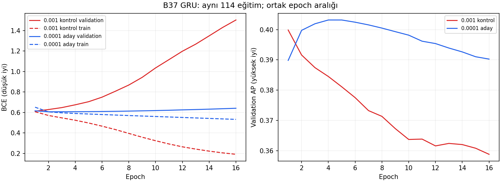

# B37 öğrenme hızı: sonuç incelemesi

**0.0001 öğrenme hızı fayda sağladı, fakat aşırı öğrenmeyi ve seçici sinyal
sorununu çözmedi.** Minimum validation BCE iyileşti; AP kazancı küçük.
Bu nedenle sonuç yalnız öğrenmenin yavaşlaması değil, seçilmiş ağırlıkların
kalitesinde de sınırlı iyileşmedir. Genel başarı veya final teste hazırlık
ilan edilmiyor.

## Aynı 114 eğitimde sonuç

| Ölçüt | Kontrol 0.001 | Aday 0.0001 |
|---|---:|---:|
| Ortalama seçilmiş validation BCE (düşük iyi) | 0,60947 | 0,60115 |
| Ortalama seçilmiş validation AP (yüksek iyi) | 0,40493 | 0,41026 |
| Ortalama en iyi epoch | 1,37 | 4,76 |
| Medyan en iyi epoch | 1 | 3 |
| İlk 3 epoch'ta seçilen eğitim | 110/114 | 68/114 |
| Eğitim başına ortalama sinyal, eşik 0.5 | 99,24 | 64,11 |
| Sıfır sinyalli eğitim, eşik 0.5 | 1/114 | 23/114 |

BCE 88/114 çiftte, AP 65/114 çiftte iyileşti; ikisi birlikte 55/114 çiftte
iyileşti. Üç seed'in her birinde ortalama BCE ve AP iyileşiyor. Ancak her
dönemde iyileşme yok. Örneğin son fold'da AP değişimi seed 42/43/44 için
yaklaşık +0,0001 / −0,0048 / −0,0309.

Solda düşük öğrenme hızının validation BCE bozulmasını ciddi ölçüde
yavaşlattığı görülüyor. Aynı 16. epoch'taki ortalama validation BCE
1,5033 → 0,6407. Sağda AP önce yükseliyor, yaklaşık 4–5. epoch'tan sonra
ortalama olarak geriliyor. Yeni modelde tüm eğitimlerin son epoch'u,
seçilen epoch'tan daha yüksek BCE'ye sahip; 76/114 eğitimde AP de düşüyor.
Minimumdan sonra BCE artışı seçim gereği beklenir; aşırı öğrenme yorumunun
dayanağı ayrıca düşen train eğrisi ve AP'nin sonraki gerilemesidir.

Grafik ortak ilk 16 epoch'ta aynı 114 eğitimin eşit ağırlıklı ortalamasıdır.
Train BCE güncellemeler sırasında/dropout açık; validation epoch sonunda/eval.
Mutlak train–validation farkını saf genelleme açığı olarak yorumlamıyoruz.

## Seed kararlılığı iyileşti mi?

Aynı fold içindeki üç seed'in en yüksek–en düşük seçilmiş BCE farkının
medyanı 0,01297 → 0,00674; AP farkının medyanı 0,03115 → 0,02363.
Bu ölçütlerde değişkenlik azalmış. Ancak bu, sinyal kararları kararlı demek
değil: son fold'da üç seed sırasıyla 44 / 12 / 35 sinyal üretiyor.
Seed/foldlar bağımsız olmadığından istatistiksel anlamlılık iddiası yok.

## Neden rapordaki precision daha düşük görünüyor?

summary.csv **fold/seed precision ortalaması** kullanıyor ve sıfır sinyalli
grupları 0 sayıyor. Bu ortalama %45,85 → %38,54 düşüyor. Sıfır sinyalli
grupların 1'den 23'e çıkması ortalamayı etkiliyor; tek başına sinyallerin
isabeti bu ölçütten okunmamalı.

Kontrol ve aday için aynı şekilde tüm TP/FP/FN sayıları toplandığında:

| Eşik 0.5; birleştirilmiş sayımlar | Kontrol | Aday |
|---|---:|---:|
| Precision | %44,74 | %46,35 |
| Recall | %14,06 | %9,41 |
| F1 | 0,2140 | 0,1564 |

Yani verilen sinyallerin toplam isabeti hafif yükselirken sinyal kapsamı,
recall ve F1 düşüyor. Bu tablo yeni seçim yöntemi değildir; rapordaki
ortalamanın yorumunu açıklar. Örtüşen foldlar ve seedler nedeniyle bu
sayımlar benzersiz işlem sayıları veya bağımsız performans değildir.

## Karar ve açık sorular

- Mevcut 0.001 hızın gözlenen hızlı bozulmaya katkısı var; daha düşük hızda
  aynı model/veri daha az kötüleşiyor ve seçilmiş BCE iyileşiyor. Bunun tek
  temel neden olduğu veya 0.0001'in en iyi hız olduğu kanıtlanmadı.
- İlk epoch sorunu hafifledi; aday eğitimlerin %59,6'sında hâlâ ilk üç
  epoch seçiliyor. Daha fazla epoch tek başına çözüm değil.
- A6 GRU'nun önceki aynı kohorttaki BCE/AP'si 0,59433 / 0,42121 idi.
  Yeni B37 hâlâ bu iki ortalamada A'yı geçmiyor. Bu, özelliklerin tümünün
  yararsız olduğunu göstermez; A'ya aynı hız müdahalesi uygulanmadı.
- Sıradaki en küçük inceleme, **mevcut aday validation tahminleriyle eşik–
  precision–recall–sinyal sayısını kontrolle karşılaştırmak**. Yeni eğitim
  gerektirmez; düşük hızın skorları 0.5 altında toplaması ile sıralama
  kalitesi ayrıştırılabilir. Eşik düşürmek kalite sorununu otomatik çözmez;
  bu raporda yeni eşik seçilmedi.

## Doğrulama ve sınırlar

114 aday + 114 kontrolün geçmişleri ve tahminleri incelendi. Arşiv CRC,
epoch sırası, minimum BCE seçimi, patience=15 ve kayıtlı metrikler doğrulandı.
Adaylar 16–37 epoch eğitilmiş, en iyi epoch en fazla 22; 100 epoch sınırına
ulaşılmamış. Daha uzun patience ile iyileşip iyileşmeyeceği bilinmiyor.

342 kontrol artifact hash'i önceki orijinal arşivle eşleşti. Hazırlanmış
veri hash'i, 37 özellik, fold/seed, motor ve Python/torch/GPU ortamı aynı.
Yalnız öğrenme hızı ve çıktı klasörü değişmiş. Her eşleşmede validation
timestamp/etiket/dizi konumu aynı; kayıtlı AP/precision/recall/F1 tahminlerden
yeniden hesaplandı. Olasılıklardan BCE, kayıtlı logit BCE ile tolerans içinde
eşleşti. Final test sayısı 0. Ağırlıklar ZIP'te yok; yeniden inference yapılmadı.

Kaynak: kullanıcının `Downloads/learning_rate_review.zip` dosyası.
[Kontrol kaydı ve hash](checks.json), [eşleşmiş sonuçlar](paired.csv),
[seed özeti](seed_summary.csv), [eğitim denetimi](audit_by_run.csv).
Yeni eğitim, yöntem değişikliği veya geniş test paketi çalıştırılmadı.
Validation epoch seçimi için de kullanıldı; sonuçlar final test değildir.
