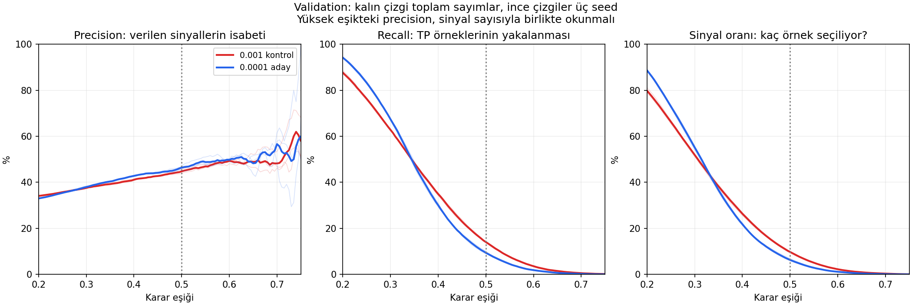

# B37: öğrenme hızı ve karar eşiği

**Sonuç:** düşük öğrenme hızında yüksek skorlar azalıyor. 0.5'te daha az
sinyal üretilmesinin önemli bir bölümü skor dağılımındaki değişimle uyumlu.
Benzer sinyal kapsamına geçildiğinde isabet yaklaşık aynı; belirgin bir
seçici sinyal üstünlüğü gösterilmiş değil. Yeni eşik seçilmedi.

Soru: mevcut exp-025 validation tahminlerinde eşik değişince precision,
recall ve sinyal oranı nasıl değişiyor? Yeni eğitim/test yok. 0–1 aralığında
0.005 adımlı betimsel tarama; aynı 114 fold/seed ve aynı örnekler kullanıldı.

## Temel karşılaştırma

| Öğrenme hızı | Eşik | Precision | Recall | Sinyal oranı | Sıfır sinyalli eğitim /114 |
|---|---:|---:|---:|---:|---:|
| Eski 0.001 | 0.40 | %41,12 | %34,90 | %26,35 | 0 |
| Yeni 0.0001 | 0.40 | %42,81 | %30,06 | %21,80 | 0 |
| Eski 0.001 | 0.45 | %42,74 | %22,96 | %16,68 | 0 |
| Yeni 0.0001 | 0.45 | %44,14 | %17,16 | %12,07 | 4 |
| Eski 0.001 | 0.50 | %44,74 | %14,06 | %9,76 | 1 |
| Yeni 0.0001 | 0.50 | %46,35 | %9,41 | %6,30 | 23 |
| Eski 0.001 | 0.60 | %49,27 | %3,57 | %2,25 | 30 |
| Yeni 0.0001 | 0.60 | %49,78 | %1,85 | %1,15 | 73 |

Precision, fold precision'larının ortalaması değil, toplam TP / toplam
sinyaldir. Recall ve F1 de toplam sayımlarla hesaplandı. Hiç sinyal yoksa
precision tanımsız bırakıldı. Foldlar ve seedler tekrar eden örnekler
içerir; bu sayımlar bağımsız veya benzersiz işlemler değildir. Eski
raporlardaki macro precision ile doğrudan karıştırılmamalı.

## Skorların tamamı mı düştü?

Hayır. Eğitim başına skor yüzdeliklerinin ortalamaları:

| Skor yüzdeliği | Eski | Yeni |
|---|---:|---:|
| Medyan | 0,3081 | 0,3129 |
| %90 | 0,4885 | 0,4590 |
| %95 | 0,5317 | 0,4942 |
| %99 | 0,5992 | 0,5436 |

Üst uç daralmış; bütün skorların sabit miktarda aşağı kaydığı söylenemez.
Ham sigmoid skorlarını kalibre edilmiş başarı olasılığı kabul etmiyoruz.

## Aynı sayıda sinyal verirsek ne oluyor?

Yalnız betimsel karşılaştırma için, eski 0.5 eşiğinin sinyal oranına en
yakın yeni grid noktası 0.465:

| Koşul | Precision | Recall | Sinyal oranı | Sıfır sinyalli eğitim |
|---|---:|---:|---:|---:|
| Eski, eşik 0.5 | %44,74 | %14,06 | %9,76 | 1 |
| Yeni, eşik 0.465 | %44,67 | %14,47 | %10,06 | 9 |

Kapsam yaklaşık eşitlendiğinde isabet neredeyse aynı. Bu, 0.5'teki recall
düşüşünün tek başına sıralama kalitesinin bozulduğu anlamına gelmediğini
gösterir. Fakat yeni modelin belirgin üstünlüğünü de göstermez. 0.465 bu
veride kapsam eşleştirmesi için hesaplandı; final test eşiği veya bağımsız
doğrulanmış karar değildir. Eğitimler arasında sinyal dağılımı hâlâ farklı.

## %60 precision bölgesi güvenilir mi?

Yeni model 0.75 eşikte toplam yalnız **35 tahmin kaydıyla** %60 precision'a
ulaşıyor; 114 eğitimin 109'unda hiç sinyal yok. Bu sayı bağımsız 35 işlem
anlamına da gelmiyor. 0.70 eşikte seed 42/43/44 için precision
%57,83 / %61,54 / %48,65 ve sinyal sayısı 83 / 39 / 37.
Dolayısıyla yüksek eşikteki yükseliş yaygın ve kararlı seçicilik kanıtı değil.
Sinyal veren az sayıdaki dönemlerin sonucu olabilir.

## Karar

Öğrenme hızını azaltmak BCE/AP'de sınırlı iyileşme sağlamıştı; bu analiz
eşik değişiminin sinyal kapsamını geri getirebildiğini, fakat aynı kapsamda
precision'ı belirgin artırmadığını gösteriyor. Sadece eşik ayarıyla sorunun
çözüldüğünü veya final teste hazır olduğumuzu söylemiyoruz.

Sonraki eğitim fikri, aynı GRU ve bu düşük hız korunarak ek özellik
gruplarının katkısını tek tek ölçmek olabilir. Hangi grubun değişeceği ve
karşılaştırma koşulları ayrıca belirlenmeli; bu raporda uygulanmadı.

## Kanıt ve kontroller

- Kaynaklar: önceki orijinal feature-comparison ZIP'i ve kullanıcının
  learning_rate_review.zip dosyası. Kaynak hashleri [checks.json](checks.json).
- 114 eşleşmenin validation zaman/etiket/dizi kimlikleri aynı.
- Sonlu ve 0–1 aralığında skorlar; eşik arttıkça azalan sinyal sayıları
  kontrol edildi. 0.5 sayımları önceki doğrulanmış raporla eşleşti.
- Epoch seçimi validation'da yapılmıştı; eşik taraması da aynı örneklerde.
  Bağımsız performans veya istatistiksel anlamlılık iddiası yok.
- Tek grafik, yeniden eğitim yok, geniş test paketi yok.

[Tüm eşikler](thresholds.csv) · [Kısa tablo](selected_thresholds.csv) ·
[Seedler](thresholds_by_seed.csv) · [Foldlar](thresholds_by_fold.csv) ·
[Skor yüzdelikleri](score_quantiles_by_run.csv)
