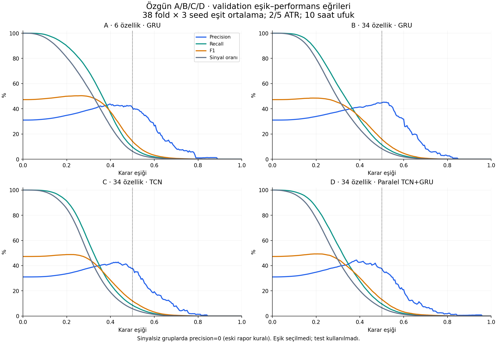
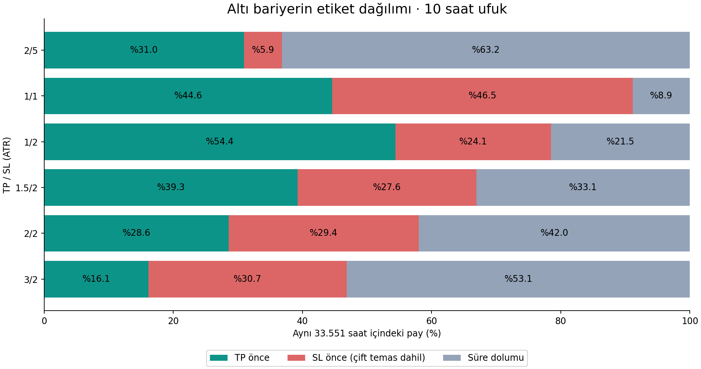
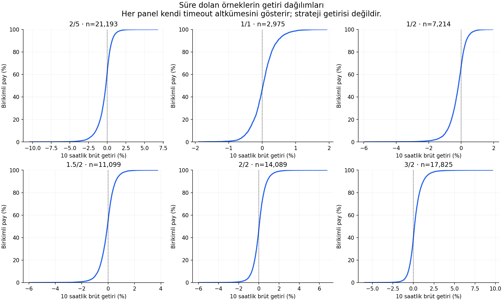

# Özgün iki araştırma sorusu: sonuçlar ve nerede kaldık?

17 Ekim 2026 · Yeni eğitim, özellik, mimari, kalibrasyon veya test yok.

## Önce kapsamı ayıralım

1. **A/B/C/D eşik incelemesi:** ilk dört modelin mevcut validation tahminleri.
   Hepsi 2/5 ATR ve 10 saat ufuk. Önceki 15 Ekim teşhisi yalnızca A'yı
   kapsıyordu; bu raporda B/C/D de tamamlandı.
2. **Altı bariyerin etiket dağılımı:** modelden bağımsız olarak aynı saatlerin
   TP/SL/timeout sayıları ve timeout getirileri. Eğitim gerektirmez.
3. **Sonradan eklediğimiz öğrenilebilirlik çalışması:** altı bariyer için aynı
   altı özellikli GRU ile 684 eğitim. Seed/dönem kararlılığı sorunu burada
   ortaya çıktı. Bu sorunun açık olması ilk iki soruyu raporlamamızı engellemez.

## 1. A/B/C/D validation eşik–performans incelemesi

A: altı özellik GRU; B: 34 özellik GRU; C: 34 özellik TCN;
D: 34 özellik paralel TCN+GRU. Dört modelde BCE eğitimi, minimum validation
BCE ile seçilmiş epoch, 38 fold ve seed 42/43/44 kullanılıyor.
Train/validation bölüm uzunlukları 5040/1080, dizi sayıları 4977/1017.

Her model için 114 dosya × 1017 = 115.938 tahmin kaydı var. Foldlar ve seedler
örtüştüğü için bunlar bağımsız gözlemler değil; model başına 27.657 benzersiz
validation saati mevcut. Test tahmini okunmadı. Eşikler 0–1, adım 0,005.
Metrikler her fold/seed'de hesaplanıp eşit ağırlıkla ortalandı; F1 ortalama
precision ve recall'dan yeniden türetilmedi.

### Eşik 0,50: özgün raporla eşleşen sonuçlar

| Model | AP | BCE | Precision | Recall | F1 | Sinyal oranı | Sinyalsiz grup |
|---|---|---|---|---|---|---|---|
| A | 0.4209 | 0.5945 | %41.05 | %9.68 | 0.1424 | %6.29 | 14/114 |
| B | 0.3974 | 0.6124 | %44.78 | %11.49 | 0.1595 | %8.33 | 2/114 |
| C | 0.3980 | 0.6071 | %37.99 | %8.69 | 0.1211 | %5.86 | 20/114 |
| D | 0.4083 | 0.6054 | %37.72 | %9.64 | 0.1323 | %6.61 | 22/114 |

**Nasıl okunmalı?** Eşik yükseldikçe daha az örnek pozitif ilan edilir ve recall
azalır. Precision'ın mutlaka artması gerekmez. Eski raporla uyum için sinyalsiz
gruplarda precision=0 kullanıldı; yüksek eşiklerde mavi eğrinin düşüşünde bu
kural da etkilidir. Bu sıfır, gözlenmiş işlemlerin tamamı yanlış demek değildir.
CSV'deki `precision_active` yalnızca sinyal üreten grupları, `no_signal_groups`
ise dışarıda kalan grupları gösterir. İkisi birlikte okunmalı; aktif grup
ortalaması da bütün dönemlerde başarı gibi sunulmamalı.

### Aynı model, farklı eşik: ne değişiyor?

| Model | Eşik | Precision | Recall | F1 | Sinyal oranı |
|---|---|---|---|---|---|
| A | 0.30 | %39.14 | %69.79 | 0.4973 | %55.92 |
| A | 0.40 | %43.66 | %36.46 | 0.3763 | %26.17 |
| A | 0.50 | %41.05 | %9.68 | 0.1424 | %6.29 |
| B | 0.30 | %37.70 | %58.29 | 0.4498 | %48.14 |
| B | 0.40 | %41.43 | %31.34 | 0.3335 | %23.76 |
| B | 0.50 | %44.78 | %11.49 | 0.1595 | %8.33 |
| C | 0.30 | %38.06 | %58.86 | 0.4518 | %48.63 |
| C | 0.40 | %41.49 | %25.31 | 0.2850 | %18.90 |
| C | 0.50 | %37.99 | %8.69 | 0.1211 | %5.86 |
| D | 0.30 | %39.24 | %56.18 | 0.4502 | %44.58 |
| D | 0.40 | %42.71 | %27.72 | 0.3029 | %20.14 |
| D | 0.50 | %37.72 | %9.64 | 0.1323 | %6.61 |

A'da 0,50 → 0,30 değişimi recall'ı %9,68 → %69,79 ve F1'i 0,1424 → 0,4973
çıkarırken sinyal oranını %6,29 → %55,92 artırıyor; precision %41,05 → %39,14.
Bu bir model iyileştirmesi değil, aynı skorların farklı karar kuralıdır.
0,30 veya başka bir eşik seçilmedi; F1 tepesini otomatik seçim kuralı yapmadık.

**AP/BCE iyi görünürken recall neden düşük?** AP skorların sıralamasını, BCE
olasılık skorlarının kaybını değerlendirir; ikisi de 0,50 karar eşiğinden bağımsız.
Dört modelde pozitif sınıfın fold/seed ortalama skoru yaklaşık 0,33–0,36,
negatif sınıfınki 0,28–0,30. 0,50'de pozitiflerin çoğu eşik altında kalır.
Bu yüzden kısmi sıralama becerisiyle düşük recall/F1 birlikte görülebilir.
Validation pozitif oranı ortalama %31,05; AP değerleri bu referans seviyesinin
üstündedir. BCE karşılaştırmasında doğru referans ilgili fold'un train sınıf
oranıdır; A–D arasındaki BCE sıralaması tek başına referansa karşı başarı kanıtı
değildir. Eylül final testindeki iyileşme ile buradaki validation metrikleri
aynı tabloya karıştırılmamalıdır.

Skorların örtüşmesi eşik değişikliğiyle yok olmaz. Bu bulgular tek başına
kalibrasyon hatasını, modelin tamamen başarısız olduğunu veya nedenin kesin
olarak aşırı uyum olduğunu ispatlamaz. Epoch ve teşhis aynı validation'ı
kullandığından bunlar bağımsız genelleme ölçümleri değildir.

## 2. Altı bariyerin etiket dağılımı

Aynı 33.551 geliştirme saati: 1 Mart 2022 04:00–28 Aralık 2025 02:00 UTC.
Ufuk girişten sonraki 10 saatlik mumdur; giriş mumunun geleceği kullanılmaz.
Mevcut etiketlerde ATR giriş anında sabitlenir. Aynı saatte iki bariyerin de
vurulması saatlik OHLC'den sıralanamaz; özgün stop-first kuralıyla SL'ye sayılır.
TP önce = 1; SL önce veya timeout = 0. Son satırların 10 saatlik ufku özgün
ham snapshot uzantısında tamamlanmıştır. Yeni etiket hesaplanmadı.

| TP/SL ATR | TP önce sayı (%) | SL önce sayı (%) | Timeout sayı (%) | Çift temas (SL içinde) |
|---|---|---|---|---|
| 2/5 | 10,387 (%30.96) | 1,971 (%5.87) | 21,193 (%63.17) | 22 |
| 1/1 | 14,971 (%44.62) | 15,605 (%46.51) | 2,975 (%8.87) | 633 |
| 1/2 | 18,248 (%54.39) | 8,089 (%24.11) | 7,214 (%21.50) | 241 |
| 1.5/2 | 13,182 (%39.29) | 9,270 (%27.63) | 11,099 (%33.08) | 174 |
| 2/2 | 9,590 (%28.58) | 9,872 (%29.42) | 14,089 (%41.99) | 122 |
| 3/2 | 5,417 (%16.15) | 10,309 (%30.73) | 17,825 (%53.13) | 62 |

2/5'te en yaygın sonuç SL değil, %63,17 timeout. 2/2'ye geçince SL teması
artıyor, timeout azalıyor. 3/2'de daha uzak TP nedeniyle pozitif oranı düşüyor.
1/1'de timeout azalırken aynı mumda çift temas belirsizliği artıyor.
1/2'de daha yüksek pozitif oran, daha başarılı model anlamına gelmez.

### Timeout getirileri

| TP/SL | Ortalama % | Medyan % | %5–%95 getiri aralığı | Pozitif getirili timeout % |
|---|---|---|---|---|
| 2/5 | -0.339 | -0.188 | -2.105 / 0.966 | 37.69 |
| 1/1 | 0.029 | 0.025 | -0.558 / 0.642 | 53.24 |
| 1/2 | -0.243 | -0.170 | -1.149 / 0.494 | 32.80 |
| 1.5/2 | -0.087 | -0.052 | -1.047 / 0.823 | 44.72 |
| 2/2 | 0.042 | 0.024 | -0.981 / 1.146 | 52.08 |
| 3/2 | 0.230 | 0.131 | -0.905 / 1.659 | 59.84 |

Birikimli grafik, örneklerin yüzde kaçının belirli bir getirinin altında kaldığını
gösterir; panellerin x eksenleri farklıdır. Her bariyerin timeout örnekleri farklıdır.
Bunlar 10 saatlik brüt kapanış getirileri; modelin seçtiği işlemler, ücretler veya
strateji getirisi değildir. Pozitif getirili timeout'un etiketi yine 0'dır:
hedefimiz pozitif kapanış değil, ufuk içinde TP'ye önce ulaşılmasıdır.

## 3. Altı bariyerin eğitimlerinde nerede kaldık?

Son A100 çalışmasında her bariyer için 114, toplam 684 train/validation sonucu
raporlanabilir durumda. Bu rapor için yeniden eğitim gerekmiyor. Ancak B32
seed44 fold34 ağırlık eksikliği, bazı B32 kayıtlarının kurtarılmış olması gibi
artifact sınırlamaları geçmiş raporda korunuyor; sonuçların mevcut olması bütün
checkpointlerin eksiksiz olduğu anlamına gelmez.

Tıkanma yalnızca seed farkı değil: genel eşikler son döneme taşınmıyor; yüksek
precision bazen çok az sinyalden geliyor; bazı seed ve dönemlerde sıralama da
zayıflıyor. Bütün bariyerlerin veya bütün seedlerin çöktüğü söylenemez.

Örnek: 1/2 bariyerinin son fold37'sinin **tam 1017 satırlık validation'ı**:

| Seed | AP | AUC | En yüksek skor | En yüksek 102 skorda precision |
|---|---:|---:|---:|---:|
| 42 | 0,5830 | 0,5300 | 0,6532 | %70,59 |
| 43 | 0,5127 | 0,4642 | 0,6548 | %50,00 |
| 44 | 0,6148 | 0,5791 | 0,6756 | %72,55 |

Üçünde de en yüksek skor 0,70'in altında: bu eşikte sinyal yok. Seed43'te
sıralama ayrıca zayıf; diğer ikisinde üst dilimde bir miktar ayırt etme var.
Bu sonradan seçilmiş üst-dilim teşhisi, uygulanacak eşik değildir. Önceki neden
analizindeki son 507 satırlık alt bölümün AUC değerleri bu tam dönemle farklıdır;
çelişki değil, değerlendirme kapsamı farkıdır.

## 4. Gerçek hatalar ve yorum sınırları

- A'nın üç volatilite özelliği B/C/D'de yoktu. A'nın kazanması saf mimari
  üstünlüğü veya yalnızca özellik ekleme etkisi değildir. B/C/D aynı 34 özelliği
  kullandığı için kendi aralarındaki karşılaştırma bu açıdan tutarlıdır.
- Eski 18 eğitimlik bariyer çalışmasında tarihler/validation düzeni değiştirildi
  ve kullanıcı tarafından belirlenmeyen F1 seçimi eklendi. Bu yöntem sapması
  kayıtlarda açık; son 684 eğitimlik özgün kohort çalışmasıyla karıştırılmamalı.
- İlk eşik teşhisinin yalnızca A'yı kapsaması, dört model için istenen teslimin
  eksik kalmasıydı. B/C/D eğrileri bu çalışmada tamamlandı.
- %60/%65/%70 hedefleri kabul edilmiş başarı şartları değil, betimsel senaryolar.
  Çok az sinyalli yüksek precision veya bütün dönemlerin ortalaması tek başına
  güvenilir eşik seçimi değildir.
- İncelenen tahminlerde metrik/kimlik uyuşmazlığı bulunmadı. Bu, bütün veri üretim
  zincirinin hatasızlığının yeni baştan kanıtlandığı anlamına gelmez.

## Teslim ve devam sınırı

İstenen iki teşhis artık bu tek raporda: dört modelin eşik eğrileri, altı
bariyerin sayıları/yüzdeleri ve timeout dağılımları. Mevcut sonuçlarla bunlar
raporlanabilir; önce seed sorununu çözmek veya final teste geçmek gerekmiyor.
Regresyon/ağaç, yeni mimari/özellik ve eğitim önerileri bu teslimin dışında.
Önce bu iki sorunun bulguları değerlendirilir; sonraki deney ayrı karardır.

## Kanıt ve tekrar üretim

- [A–D özgün inceleme](../../../docs/advisor-abcd-validation-review.md)
- [Önceki A eşik teşhisi](../diagnostics-20261015/REPORT.md)
- [Etiket genişletme](../barrier-expansion-20261015/REPORT.md)
- [684 eğitim incelemesi](../selective-review-20261017/REPORT.md)
- [Seed/dönem teşhisi](../stability-20261017/REPORT.md)
- [Dört model: bütün eşikler](abcd_thresholds.csv), [seçilmiş referans noktaları](abcd_selected_thresholds.csv),
  [seed eğrileri](abcd_seed_curves.csv), [skor metrikleri](abcd_score_metrics.csv)
- [Altı bariyer sayıları](six_barrier_counts.csv), [timeout yüzdelikleri](six_barrier_timeout_returns.csv)

456 tahmin dosyası ve 8 protokol/özet özgün review SHA256'larıyla eşleşti.
A/B/C/D timestamp, etiket, kaynak satır ve ileri getiri kimlikleri birebir aynı.
0,50 metrikleri eski özetlerle; A'nın önceki teşhis noktaları eski CSV ile eşleşti.
Altı etiket dosyası ve eski dağılım tablosu hash ile doğrulandı; 33.551 timestamp,
TP/SL/timeout sayıları ve timeout ortalamaları eski sonuçlarla eşleşti.

Çalıştırma kodu ve girdi manifesti `reports/question-recap-20261017/` altında;
kodun ve manifestin içerik hashli metin kopyaları deney defterinde korunur.
İlk çalıştırmada eski CSV'nin `scenario` sütunu `barrier` sanıldığı için yalnızca
bariyer raporlama adımı durdu. Sütun eşlemesi düzeltildi; tamamlanmış 456 model
hesabı tekrarlanmadı. Ara devam komutundaki dosya-kökü hatası da düzeltildi.
Hiçbir kaynak dosya, etiket, checkpoint veya eski rapor değiştirilmedi.
