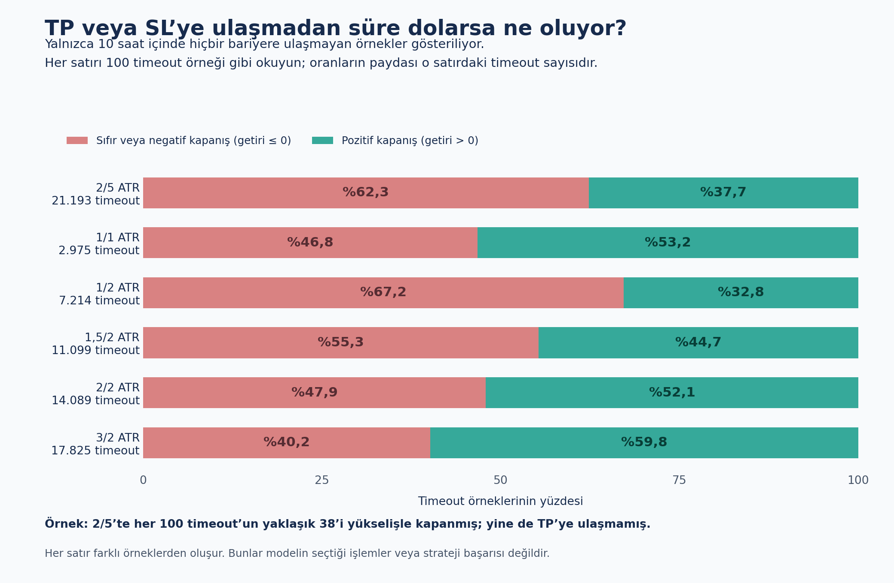
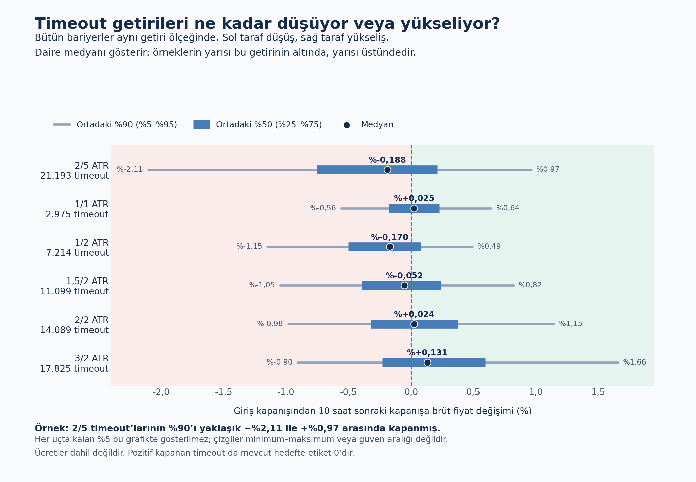

# Timeout grafiklerini okumak

Bu görseller önceki sonuçların daha açıklayıcı sunumudur; yeni deney veya metrik seçimi yoktur.
Eski rapor ve grafikler korunmuştur.

## 1. Her 100 timeout örneğinin kaçı pozitif kapanıyor?

Yeşil: 10 saat sonunda pozitif getiri. Kırmızı: sıfır veya negatif getiri.
Payda bütün veri değil, ilgili bariyerin timeout örnekleridir.
Örneğin 2/5 için yaklaşık %38 pozitif kapanmıştır ama TP'ye ulaşmamıştır.

## 2. Getiriler hangi aralıkta toplanıyor?

- Nokta: medyan; örneklerin yarısının altında, yarısının üstünde kaldığı getiri.
- Kalın mavi bölüm: ortadaki %50 (%25–%75 yüzdelikleri).
- İnce çizgi: ortadaki %90 (%5–%95 yüzdelikleri). Uçlardaki %5'er gösterilmez.
- Bütün satırlarda aynı ölçek kullanılır. Sıfırın solu düşüş, sağı yükseliştir.

Her satır farklı timeout örneklerinden oluşur. Grafikler model başarısı veya
strateji kârlılığı değildir. Pozitif timeout mevcut hedefte etiket 0 olmaya devam eder.

Kaynaklar: [timeout özeti](../six_barrier_timeout_returns.csv) ve
[ana rapor](../REPORT.md). Kod kopyası: [render-source.txt](render-source.txt).
