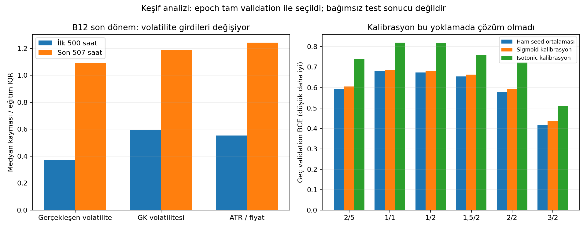

# Neden analizi ve çözüm yoklamaları

17 Ekim 2026 · exp-019-root-cause-probes · ebeveyn exp-018-validation-stability.

## Sonuç

Tek bir kod hatası veya doğrulanmış tek neden bulunmadı. Kanıtlar üç bileşeni
destekliyor: girdi/etiket dağılımı değişimi, seed'e göre farklı ve bazen ters
sıralama, eğitim ilerledikçe validation hatasının artması. Sabit puan eşiklerini
farklı modellere taşımak bu sorunları görünür hale getiriyor; onları yaratmıyor.

Sınırlı post-processing yoklamalarında seed ortalaması küçük fayda sağladı;
kalibrasyon ve geçmiş skor kantili son dönem sorununu çözmedi. Komşu pencere
ortalaması da B12 için genel çözüm olmadı. Kesin çözüm bulunmuş gibi test açılmadı.

## Kaynak kimliği ve korunan sınırlar

- Kaynak review ZIP SHA256:
  `76d09912ab27349d003041a4f2356fbe989cbd76601feaa4793d8e342ca16eff`.
- Drive B12.parquet SHA256:
  `3792e9b687d086231588f4341b7fef80097a1f44c78dcf3073c201334b33f091`;
  mevcut cohort kaydıyla birebir eşleşti. Hesap `icinbedava34@gmail.com` doğrulandı.
- Timestamp + altı özellik fingerprint'i:
  `03e1adfe0f87ffd151b1850cd71b1dab11a2fc3e208545090840692d11ba1b48`;
  33551 saatlik mevcut çalışmanın ortak girdi kimliğiyle eşleşti.
- B12'nin114 validation dosyasındaki etiket/timestamp bu prepared tabloyla eşleşti;
  altı girdi özelliğinde nonfinite değer yok. Bu kontrol bütün ham mumların veya
  diğer beş adayın etiket üretiminin bağımsız yeniden denetimi değildir.
- ../yeniBot yerel tablosu aynı tarihleri taşısa da kaynak ve girdi hash'leri farklı;
  mevcut modellerin drift analizi için kullanılmadı. Dış projenin değişikliklerine
  dokunulmadı, kodu bu projeye kopyalanmadı veya merge edilmedi.
- GRU yeniden eğitilmedi; Eylül/Ekim testleri okunmadı; eski checkpoint veya sonuç
  değiştirilmedi. Kalibrasyon yalnızca aşağıda açıklanan keşif diliminde fit edildi.

## Eski projede ne yapılmış?

Salt okunur incelenen kaynaklar (yerel HEAD 741d1d4; çalışma ağacı ayrıca değişiklikler
taşıyor, kaynak hash'leri PROVENANCE.md içinde):

| Parça | Bulgu | Bu çalışmaya aktarım kararı |
|---|---|---|
| docs/current-status.md | TCN+GRU temelli Phase1;36 model fold ensemble; validation'dan eşik0,423638; aktif v4 araştırma koşulları geçmiş, bağımsız gelecek OOS bekleniyor | Aynı GRU/6 özellik deneyi değil; "sorun kesin çözülmüş" sonucu çıkarılmaz |
| diagnostics/calibration.py | Fold validation'da isotonic veya raw-score logistic kalibrasyon; testte transform | Fikir sınırlı ileri-zaman yoklamasıyla sınandı; doğrudan eklenmedi |
| experiment/holdout.py:464 | Aynı timestamp için farklı model-fold puanlarının aritmetik ortalaması | Aynıfold seed ortalaması ve ortak saatlerde komşufold ortalaması ayrı sınandı |
| config.yaml:1701 | Eski Phase1 epoch seçimi rank_ic; burada BCE | Return RankIC, TP sınıflandırma hedefiyle aynı değil; otomatik aktarılmadı |
| docs/experiment-history.md ve SKILLS.md | Rejim eşikleri, pairwise loss ve bazı eğitim/regularizasyon denemeleri başarısız | Aynı denemeler çözüm diye tekrarlanmadı |
| docs/current-status.md:46 | Ham sigmoid puanların güvenilir olasılık olmadığı açıkça yazıyor | Kalibrasyon sorununun kesin çözülmüş olduğu iddiası yok |

Eski projedeki test-oracle tabloları veya görülmüş holdout sonuçları bu projede
parametre seçmek için kullanılmadı. Oradaki kabul koşulları buraya taşınmadı.

## Mekanizma 1 — aynı validation dönemi içinde dağılım değişiyor

Son fold37 B12, ilk500 tahmin ile son507 tahmin; arada10 saat etiket olgunlaşma boşluğu:

| Ölçüm | Eğitim | Validation ilk500 | Validation son507 |
|---|---:|---:|---:|
| Pozitif oranı | %56,38* | %55,20 | %47,73 |
| realized_vol_14 medyanı | 0,002924 | 0,003624 | 0,004967 |
| gk_vol_14 medyanı | 0,003393 | 0,004516 | 0,005647 |
| atr_14_pct medyanı | 0,005031 | 0,006512 | 0,008357 |

*Train pozitif oranı önceki model referansındaki dizi sonlarından hesaplanmıştır;
özellik medyanları scaler'ın fit edildiği5040 train satırından hesaplanmıştır.

Son yarıda volatilite medyanları eğitim medyanından yaklaşık1,09/1,19/1,24 eğitim
IQR'ı yukarıda. Bu üç özellikte eğitim p01–p99 aralığı dışındaki saatler yaklaşık
%5,1–6,5; tablo bütünüyle bozulmuş veya tamamen eğitim aralığı dışında değil.
Dağılım farkı histogram PSI ile de raporlandı; PSI betimsel ölçüdür, nedensellik
veya istatistiksel anlamlılık testi değildir. Son fold'un tam-validation PSI'si
önceki dönemler içinde yaklaşık %79–84 yüzdeliklerde; yüksek ama tekil değil.

Altı girdinin üçü volatiliteyi temsil ediyor. GK ile ATR/fiyat Spearman korelasyonu
0,986; realized-vol ile diğerleri0,897/0,924. Bu, benzer bilginin birden fazla
girdide bulunduğunu gösterir; özellik silmenin başarılı olacağını kanıtlamaz.

## Mekanizma 2 — öğrenilen ayrım seed ve zamanla kararlı değil

| B12 son fold | İlk500 AUC | Son507 AUC | İlk500 max puan | Son507 max puan |
|---|---:|---:|---:|---:|
| Seed42 | 0,550 | 0,503 | 0,653 | 0,569 |
| Seed43 | 0,476 | 0,447 | 0,655 | 0,610 |
| Seed44 | 0,567 | 0,602 | 0,676 | 0,609 |

Seed43'ün sorunu ikinci yarıda başlamıyor; ilk yarıda da sıralaması zayıf.
Seed44 aynı değişen piyasada ayrımı koruyabiliyor. Bu yüzden sorun yalnızca
"piyasa değişti" veya "olasılık ölçeği yanlış" diye açıklanamaz.

Örnek ilişki: son yarıda ATR/fiyat ile TP etiketi korelasyonu−0,174 iken
model puanları ile ATR/fiyat korelasyonu seed42/43/44 için+0,464/+0,574/+0,267.
Bu basit eşzamanlı ilişkiler ters yönlü bir model davranışı şüphesi yaratıyor;
GRU64 saatlik diziyi kullandığından tek özellik etkisi veya neden kanıtı değildir.

## Mekanizma 3 — fazla epoch çözüm değil; seçim hedefleri de farklı

Üç B12 son-fold modeli minimum validation BCE'yi epoch1'de buluyor. Son epoch16'da
train BCE düşerken validation BCE artıyor; bu overfitting ile tutarlı.
Seed43'te en yüksek validation AP epoch7'de0,5516, seçilmiş epoch1'de0,5127;
ancak BCE0,7092'den0,7523'e kötüleşiyor. Seed44'te AP de epoch1'de en iyi.

684 geçmişte278 modelin sonradan görülen maksimum AP'si seçilmiş AP'den0,02'den
fazla yüksek. Bu bir objective çatışması teşhisidir. Aynı validation'a bakıp en iyi
AP epoch'unu seçmek ve başarı ilan etmek doğru olmaz. Mevcut checkpointlerin sadece
BCE-best state'i ve son state'i var; ara epoch tahmin/weights'leri genelde yok.
Bu nedenle alternatif epoch kuralının gerçek precision/kararlılık değerlendirmesi
sonuçlardan güvenilir biçimde yeniden üretilemez.

Kaynak kod incelemesinde scaler train'de fit ediliyor, validation'da model.eval()
kullanılıyor, best_state clone edilerek korunuyor, epoch sonunda best_state
yükleniyor. Bu kontrollerde açık bir yanlış checkpoint/eval/scale uygulaması bulunmadı;
bu tüm motor için yeni bir tam doğruluk sertifikası değildir.

## Çözüm yoklamaları — sınırlar önce

Her fold'da ilk500 validation satırı post-processing fit kaynağı;10 saat boşluk;
son507 karşılaştırma. Tüm yöntemler aynı507 satırda ölçülür. **Epoch önceden tüm
validation'dan seçildiği için bu bağımsız validation/test değildir**; yalnızca
mekanizma yoklaması. Eski train/validation sınırları değiştirilmedi.

Raw seed42/43/44, eşit seed ortalaması; her biri için raw / pozitif-eğimli sigmoid /
isotonic: 6×38×4×3 =2736 satır. Sigmoid eski projedeki raw-score logistic C=1
yapısını izler; negatif eğimde puanları ters çevirmek yerine ilk bölümün sabit
pozitif oranı fallback'i kaydedilir.52/912 sigmoid fit'te bu fallback oluştu.
Bu özel sigmoid kurulumu, bütün kalibrasyon yöntemlerinin başarısızlığını kanıtlamaz.

### H1: kalibrasyon

B12 eşit seed ortalaması, son507 satırların38 dönem ortalaması:

| Yöntem | AP | AUC | BCE | Brier |
|---|---:|---:|---:|---:|
| Ham | 0,6219 | 0,5825 | **0,6743** | **0,2407** |
| Sigmoid | 0,6219 | 0,5825 | 0,6805 | 0,2438 |
| Isotonic | 0,6026 | 0,5746 | 0,8173 | 0,2485 |

Bu kurulumda altı bariyerin hepsinde ham seed ortalamasının BCE'si iki kalibrasyon
yönteminden de daha iyi.500 bağımlı gözlemle isotonic aşırı uç/tie üretebilir;
olasılık uçlarına çok yüksek ceza veren BCE burada özellikle kötüleşiyor.
Sonuç: kalibrasyon bu yoklamada çözüm değil. Pozitif sigmoid sıralamayı korur;
seed43 gibi zayıf ayrımı tek başına onaramaz. Isotonic de zayıf sıralamadan yeni
bilgi üretmez; eşit puanlar oluşturarak ölçülen sıralamayı değiştirebilir.
Yöntem sınırı: [scikit-learn calibration](https://scikit-learn.org/stable/modules/calibration.html).

### H2: aynı fold'da seed ortalaması

B12 tekseedlerin eşit metrik ortalaması AP0,6183/BCE0,6774; puanların eşit
ortalaması AP0,6219/BCE0,6743. AP38 dönemin24'ünde iyileşiyor. BCE38/38'de
tekseedlerin ortalama BCE'sinden düşük; log-loss'un olasılıkta konveksliği nedeniyle
bu beklenebilir, tek başına yeni bağımsız edge kanıtı değil.

Son fold'un geç bölümünde ensemble AUC0,515 ve AP0,495; pozitif oranı0,477.
Genel küçük fayda var, son kötü dönemi çözmüyor. Başarısına göre seed çıkarılmadı.

### H3: erken puan kantilinden eşik

İlk500 puanın %90 kantilini sabitleyip son507'ye uyguladık. Gelecekteki puan
dağılımına bakarak top%10 seçilmedi. B12 sonfold raw seed42/43/44 için
sinyal sayısı0/5/0; eşit seed ortalaması0. Seed43'ün5 sinyalinin hiçbiri TP değil.
Bu, dönem içi puan kayması nedeniyle geçmiş quantile eşiğinin de taşınamadığını
gösteriyor. Bir kalibrasyon sabit puan ürettiğinde p>=q90 tüm507 satırı seçebiliyor;
bu bir başarı değil, sabit-puan/tie tehlikesi olarak kaydedildi.

### H6: farklı eğitim pencerelerini ortalamak

Eski projedeki36-fold ensemble'ın tam yeniden üretimi yapılmadı. Mevcut tahminler
yalnızca komşu foldların ortak297 saatinde karşılaştırmaya izin veriyor. Her iki
train aralığı o saatlerden önce bitiyor; epoch seçimi sınırı yine geçerli.
37 çift×6 aday×3 yöntem =666 satır; gelecekte eğitilmiş modeller eklenmedi.

B12: yeni3-seed ortalaması AP0,6257/BCE0,6747; komşu6-model ortalaması
AP0,6240/BCE0,6748. Son çiftte de yeni pencere AP0,6824; ortak ortalama0,6655.
Bazı diğer bariyerlerde küçük kazanım var; B12 için genel çözüm desteği yok.

## Ne çözüldü, ne çözülmedi?

- Yanlış eşik aktarımı ve ortalamaların yorumlanması teşhis edildi; puanlar güvenilir
  ortak olasılık ölçeği gibi ele alınmamalı. Bu raporlama/araştırma düzeyinde düzeltme.
- Mevcut modellerin seed/dönem kararlılığı düzelmiş değil. Teste hazır denmedi.
- Kalibrasyonu, rejim eşiğini veya eski projedeki ensemble'ı otomatik kopyalamak
  için dayanak yok. Olumsuz yoklamalar da araştırma hafızasında saklandı.
- Girdi değişimi somut; hangi özellik/model kapasitesi/optimizasyon bileşeninin
  bozulmaya neden olduğunu ayırmak için kontrollü eğitim müdahalesi gerekiyor.

## Sıradaki somut çözüm deneyi önerisi — henüz çalıştırılmadı

Tek değişkenli kapasite yoklaması: aynı6 özellik/etiket/BCE/optimizer/seed/split ile
GRU hidden128 kontrolüne karşı hidden32. Katman sayısı2 ve head ayarları aynı
kalır; girdi, tarih veya eşik hedefi değiştirilmez. Gerekçe:168k civarı parametreli
mevcut modelde az epoch'ta validation bozulması ve seed duyarlılığı; kapasite bunun
nedeni olarak henüz kanıtlanmadı. Bu eski projenin aynı anda dropout/weight-decay/
validation değiştiren başarısız denemesinin tekrarı değildir.

Önce B12 son üç ardışık fold35–37, üç seed:9 yeni eğitim; mevcut eşleşmiş kontroller
korunur. Bu, sorun görüldükten sonra seçilmiş keşif pilotudur; genel üstünlük kanıtı
değildir. Her epoch'ta doğrulanabilir metrik ve tahmin/kimlik kaydı saklanmalı.
Pilot tüm üç dönemde ortalama BCE'yi ve AP kazancını iyileştirip seedler arası
yayılımı azaltırsa, sonuçlar seçilmeden tüm38-fold doğrulamasına genişletilebilir;
aksi halde reddedilir. Test, bu adayın seçimi/onarımı için kullanılmaz.

Bu belge aday eğitimin notebooku değildir; ana frozen engine değiştirilmedi.
Yeni eğitim gerekirse ayrı workspace/deney kimliğiyle Colab A100 üzerinde yapılmalı.
Neden analizi ve sınırlı post-processing yoklamaları tamamlandı; kapasite yoklaması
için henüz yeni bir eğitim çalıştırılmadı veya Colab yürütücüsü hazırlanmadı.

