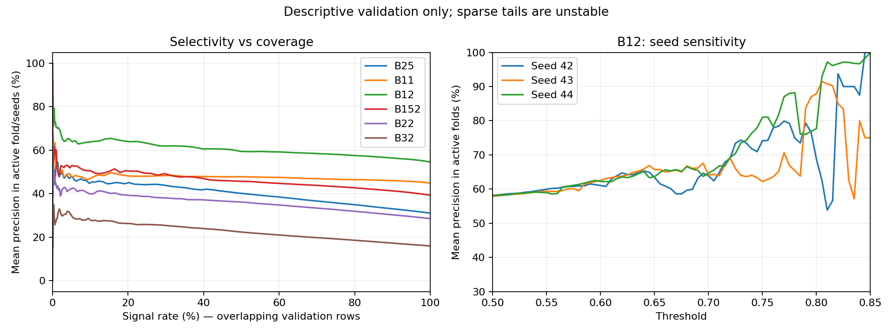

# Seçici sinyal çalışması: kurtarma sonrası inceleme

Kaynak: [Drive review ZIP](https://drive.google.com/file/d/1EVi4IKX0JNQbByTEIRTAvRmCnJ6lJTPg/view).
ZIP SHA256: `76d09912ab27349d003041a4f2356fbe989cbd76601feaa4793d8e342ca16eff`.

## Bütünlük

ZIP CRC geçerli. 2052 rapor dosyası hash eşleşmesi; 684 tahmin dosyasında AP/BCE yeniden hesaplaması ve 1017 satır kontrolü; 684 geçmişte minimum validation BCE epoch kontrolü: hata yok. Test sayısı 0. Ham prepared veriler ve model ağırlıkları ZIP dışında; bağımsız ham veri/etiket ve ağırlık denetimi yapılmadı.

Kohort 33551 saat, 38 fold, 3 seed, 6 aday. Her aday 114 tamamlanmış sonuç. Train/validation 5040/1080 satır; diziler 4977/1017. Rapor başına 115938 tahmin satırı, 27657 benzersiz validation saati: satırlar bağımsız örnek değildir.

B32 seed44 fold34 ağırlıkları eksik; mevcut tahmin/raporlar korunmuş. Fold35 geçmişi checkpointten oluşturulmuş; fold36 epoch27 sonrası tamamlanmış (en iyi12, patience15); fold37 yeniden eğitilmiş (en iyi4, son19). Fold37 validation BCE 0.341382 iken son epoch 0.597002: overfitting; seçim doğru biçimde epoch4. Bu dört foldun provenance farkı korunmalıdır.

## Referansa göre sonuçlar

AP ve BCE eşit fold/seed ortalamasıdır. BCE skill, eğitim pozitif oranını sabit olasılık veren referansa göre fold bazlı göreli iyileşme ortalamasıdır. Bariyerler farklı hedefler olduğundan mutlak AP/BCE ile kazanan seçilemez.

| Aday | Pozitif % | AP | BCE | BCE skill % | Referanstan kötü /114 |
|---|---:|---:|---:|---:|---:|
| B25 | 31.05 | 0.4212 | 0.5943 | 4.18 | 10 |
| B11 | 44.79 | 0.4808 | 0.6844 | 0.54 | 44 |
| B12 | 54.56 | 0.6075 | 0.6785 | 1.56 | 14 |
| B152 | 39.33 | 0.4691 | 0.6561 | 2.19 | 11 |
| B22 | 28.52 | 0.3739 | 0.5788 | 3.31 | 7 |
| B32 | 15.98 | 0.2533 | 0.4182 | 4.91 | 10 |

B11 referans üstü kazanımı zayıf. B32 iyi göreli BCE kazanımına rağmen bu eşik ızgarasında aktif-fold ortalama precision %60 olmuyor. B12 seçicilik incelemesi için dikkat çekiyor; kazanan veya test başarısı olarak ilan edilmedi.

## B12 eşik örnekleri (önerilen politika değildir)

| Eşik | Aktif-fold precision % | Birleşik precision % | Recall % | Sinyal oranı % | Sinyalsiz fold/seed % |
|---|---:|---:|---:|---:|---:|
| 0.565 | 60.23 | 60.34 | 52.18 | 47.47 | 0.88 |
| 0.640 | 65.45 | 63.02 | 17.52 | 15.34 | 7.02 |
| 0.730 | 70.44 | 70.50 | 1.89 | 1.48 | 40.35 |

Birleşik precision toplam TP/toplam sinyal; örtüşen zamanlar ve seed tekrarları içerir, bağımsız işlem başarısı değildir. 0.64 eşiğinde aktif-fold ortalaması %65.45 fakat birleşik %63.02; 114 fold/seedin yalnızca 48 tanesi %65 üstü. Aktif precision alt %10 dilimi %55.96. 0.73 eşiğinde seed42/43/44 precision ortalamaları %74.33/%64.02/%73.50; sinyal medyanı yalnızca5.

## Raporlama sorunu ve yorum sınırları

Mevcut precision_60/65/70 dosyaları tüm 114 fold/seedde en az bir sinyal şartını uyguluyor. Bu kullanıcı tarafından kilitlenmiş bir kabul koşulu değil. Tüm dosyaların boş olması hiçbir seçici eşikte hedefe yaklaşılmadığı anlamına gelmez. Koşul kaldırılarak başarı ilan edilmemeli: sonraki rapor sürümü aktif ortalama, birleşik precision, sinyalsiz oran, sinyal desteği ve dönem/seed dağılımını ayrı göstermeli. Eski raporlar değişmedi.

Negatif etiket SL yanında timeout da içeriyor. Örneğin B25 kohortunda 21193/33551 (%63.17) timeout var. Dolayısıyla model TP önce gelir mi sorusunu öğreniyor; negatif tahmin SL kesin gelir demek değil.

Epoch seçimi ve bu inceleme aynı validation üzerinde: sonuçlar iyimser olabilir. Burada eğitim, yeni test veya eşik seçimi yapılmadı. Önce kabul ölçütü ve değerlendirme prosedürü dondurulmalı; test sonrasında değiştirilmemeli.

