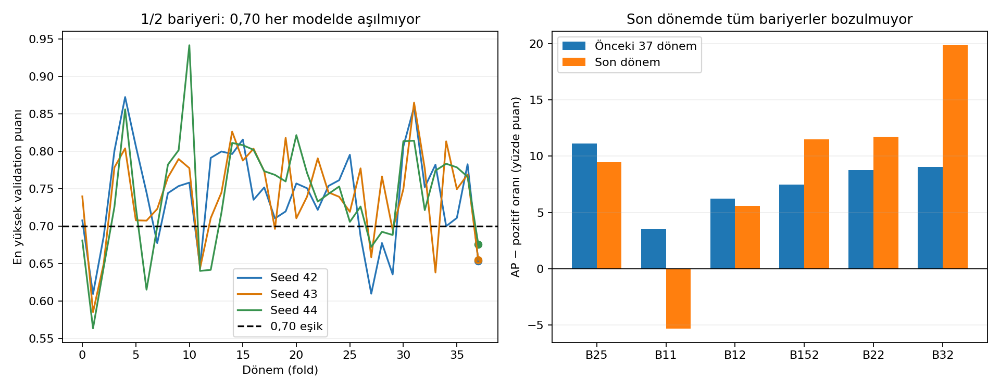
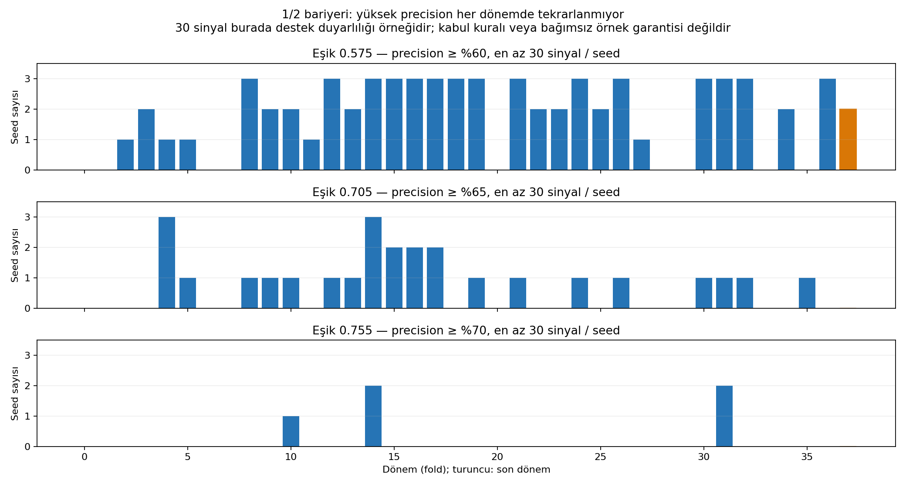

# Eşik sorununun teşhisi: puan dağılımı, ayırt etme ve dönem tutarlılığı

17 Ekim 2026 · exp-018-validation-stability · ebeveyn exp-017-threshold-transfer.

## Kapsam ve yöntem

Kullanıcı üç sorunun incelenmesini istedi. Altı bariyerin 38 fold × 3 seed
validation tahminleri okundu. Kaynak ZIP SHA256
`76d09912ab27349d003041a4f2356fbe989cbd76601feaa4793d8e342ca16eff`.
[Kaynak ZIP](https://drive.google.com/file/d/1EVi4IKX0JNQbByTEIRTAvRmCnJ6lJTPg/view).
Yeni eğitim, test verisi okuma, kalibrasyon fit'i veya eşik optimizasyonu yapılmadı.
201 eşik eğrilerinden önceki analizlerde konuşulan 0,40/0,50/0,575/0,620/0,640/
0,705/0,755 noktaları incelendi; başarıya göre yeni nokta aranmadı.

684 dosyada 1017 benzersiz sıralı timestamp, sonlu [0,1] puanlar, kayıtlı AP/BCE
ile yeniden hesaplanan değerler ve seedler arası timestamp/etiket eşitliği kontrol
edildi. Hesaplama uyuşmazlığı bulunmadı. Bu ham girdilerin veya model ağırlıklarının
doğrulandığı anlamına gelmez; ZIP bunları içermiyor.

## 1. Son dönemde puanlar neden 0,70'e ulaşmıyor?

B12 (1/2) son fold37'nin gerçek validation tahminleri:
14 Ekim 2025 19:00 – 26 Kasım 2025 03:00 UTC. Bölüm 12 Ekim'de başlar;
ilk 63 saat dizinin geçmiş bağlamıdır. Üç seed aynı 1017 saati tahmin ediyor.

| Seed | Ortalama puan | Puan std | En yüksek puan | En iyi epoch |
|---|---:|---:|---:|---:|
| 42 | 0,4911 | 0,0522 | 0,6532 | 1 |
| 43 | 0,5483 | 0,0499 | 0,6548 | 1 |
| 44 | 0,5095 | 0,0540 | 0,6756 | 1 |

Önceki 37 dönemde model başına maksimum puan ortalaması 0,7432; son dönemde
0,6612. Model başına puan std ortalaması önceki dönemlerde 0,0943, son dönemde
yaklaşık 0,0520. Puanlar son dönemde daha dar bir aralıkta. Her seed'in son maksimumu,
kendi 38 dönemlik maksimum dağılımının yaklaşık alt %13–18'inde; düşük fakat tekil değil.

0,70'te sinyal olmamasının doğrudan sayısal açıklaması bu. Daha fazla epoch eğitim
otomatik çözüm değil: son dönemde üç modelde de en iyi validation BCE epoch1'de;
epoch16'ya kadar iyileşme olmadığı için durulmuş. Son BCE 0,8544/0,8230/0,9083;
seçilmiş BCE 0,6933/0,7092/0,6829. Eğitim hatası düşerken validation kötüleşmiş.
Önceki 111 eğitimden 16'sında da en iyi epoch1; son dönemde üçünde birden görülüyor.

Eğitim pozitif oranı %56,38, son validation pozitif oranı %51,43. Önceki dönemlerin
validation ortalaması %54,64. Etiket oranı değişimi gözleniyor; bunun tek başına
puan daralmasının nedeni olduğu kanıtlanmadı. Özellik dağılımı ve ağırlık analizi
bu paketten yapılamaz. Piyasa rejimi/kalibrasyon/optimizasyon için nedensel teşhis
konulmadı; yalnızca gözlenen belirtiler raporlanıyor.

## 2. Ayırt etme gücü de bozulmuş mu?

B12'nin son döneminde:

| Seed | AP | Pozitif oranı | ROC AUC | BCE referansına göre iyileşme | En yüksek puanlı 102 örnekte precision |
|---|---:|---:|---:|---:|---:|
| 42 | 0,5830 | 0,5143 | 0,5300 | %0,63 | %70,59 |
| 43 | 0,5127 | 0,5143 | 0,4642 | −%1,65 | %50,00 |
| 44 | 0,6148 | 0,5143 | 0,5791 | %2,12 | %72,55 |

AP için pozitif oranı sıralama becerisi olmayan referans seviyesidir; ROC AUC
0,5 çevresi zayıf sıralamayı gösterir. AP kazancı küçük örneklerde kesin bir
istatistiksel anlamlılık iddiası değildir. BCE referansı train pozitif oranını
sabit olasılık olarak verir; pozitif skill daha düşük hata demektir.

Sonuç: yalnızca eşik ölçeği değişmemiş; seed43'te sıralama da zayıf. Seed42/44'te
yüksek puanlı altkümede ayırt etme devam ediyor. En yüksek %10 kontrolü her modelde
aynı sayıda örnek (ceil(1017×0,1)=102) seçerek puan ölçeği etkisini kısmen ayırır;
bu geçmişe dönük sıralama teşhisidir, canlı top-%10 stratejisi veya seçilmiş eşik değil.

Seed çiftlerinin son dönem Spearman puan korelasyonları 0,751 / 0,862 / 0,680.
Tamamen alakasız sıralamalar üretmiyorlar; yine de özellikle yüksek puanlı uçtaki
farklar sınıflandırma sonucunu değiştiriyor. Önceki dönem çiftlerinin ortalaması
0,788. Aynı fiyatlar ve etiketler üzerinde seed farkı bulunduğundan sorunu yalnızca
piyasa değişimine bağlamak yeterli değil.

### Diğer bariyerler de aynı biçimde mi etkilenmiş?

AP − pozitif oranı, dönem başına hesaplanıp seed/fold eşit ağırlıkla ortalanır:

| Bariyer | Önceki 37 dönem AP kazancı (puan) | Son dönem AP kazancı (puan) | Son dönem BCE iyileşmesi |
|---|---:|---:|---:|
| 2/5 | +11,12 | +9,48 | %5,02 |
| 1/1 | +3,53 | **−5,32** | **−%2,55** |
| 1/2 | +6,21 | +5,59 | %0,37 |
| 1,5/2 | +7,47 | +11,51 | %3,44 |
| 2/2 | +8,79 | +11,72 | %5,05 |
| 3/2 | +9,07 | +19,88 | %9,92 |

Son dönemde bütün modeller çökmüyor. B11 (1/1) üç seed'de de negatif BCE skill ve
0,4055/0,3871/0,4410 AUC ile belirgin zayıflıyor. B12'nin ortalama AP kazancı
tamamen kaybolmamış fakat seed farkı önemli. B32'nin bu dönemde sıralama kazanımı
artmış; yine de düşük puanlar nedeniyle 0,5'te hiç sinyal yok. Dolayısıyla sabit
eşikte sinyal yokluğu ile öğrenme becerisinin yokluğu aynı şey değil.

## 3. Yüksek precision farklı dönemlerde tekrarlanıyor mu?

B12 için önceden konuşulan üç eşik. Tüm örnekleri birleştiren precision kullanıldı;
bu değer aktif-fold ortalamasıyla karıştırılmamalı.

| Eşik | İncelenen precision | Birleşik precision | Sinyal veren model /114 | Model başına sinyal medyanı | Hedef + en az30 sinyal sağlayan model /114 | Üç seed'in birlikte sağladığı dönem /38 |
|---|---:|---:|---:|---:|---:|---:|
| 0,575 | %60 | %60,85 | 113 | 464,5 | 68 | 15 |
| 0,705 | %65 | %67,34 | 85 | 16 | 26 | 2 |
| 0,755 | %70 | %75,03 | 50 | 0 | 5 | 0 |

30 sinyal kullanıcı tarafından kabul edilmiş başarı sınırı değildir. Destek
duyarlılığını görünür kılmak için 1/10/30/100 sinyal koşulları birlikte hesaplandı
(`threshold_stability.csv`). 10 sinyal koşulunda üç seed birlikte hedefi sağlayan
dönem sayıları 15/3/1; 100 sinyal koşulunda 15/0/0. Sonuç yalnızca30 seçimine bağlı değil.

0,755'te bütün sinyallerin %64,22'si yalnızca beş fold'dan; 0,705'te %36,16'sı,
0,575'te %19,62'si beş fold'dan geliyor. Seed ve örtüşme tekrarları dahil;
bağımsız işlem sayısı veya güven aralığı olarak okunamaz.

Yanıt: %60 düzeyi birçok dönemde görülebiliyor fakat evrensel değil. Daha yüksek
precision iddiaları gittikçe az sayıda modele/döneme ve sinyale dayanıyor. %75
birleşik precision'ın bütün zamanlarda çalışan %75 doğruluklu bir sistem olarak
sunulması yanlış olur. Bu bulgu üç hedefi veya bir bariyeri otomatik seçmez.

## Karar ve bir sonraki adımın sınırı

Önceki son-fold önerisi yalnızca tarihe göre ortak bir model seçeneğiydi; bu analiz
sonrasında onun test için yeterli kaliteyi sağladığı iddia edilmiyor. Nihai model
ve eşik kilidi hazırlanmadı. Ekim testi açılmadı. Eğitim tekrarına otomatik ihtiyaç
sonucu çıkarılmadı; mevcut eğitimlerin dosyaları bu gözlemler nedeniyle geçersiz değil.

İlk araştırma konusu tek bir yüksek precision noktasını seçmek değil, seed/dönem
kararlılığını artırmak olmalı. Kalibrasyon puan ölçeğini değiştirebilir fakat zayıf
sıralamanın düzeldiği varsayılamaz. Yeni bir yöntem denemesi ayrı deney kimliği ve
validation protokolü gerektirir. Bu çalışma yeni mimari, loss, ensemble, kalibrasyon
veya veri penceresi seçmedi; aynı validation üzerinde fazladan araştırma yapıldıkça
nihai testin seçimden ayrı tutulmasının önemi artar.

## Dosyalar

- `fold_seed_diagnostics.csv`: 684 modelde puan dağılımı, AP/AUC/BCE, etiket oranı,
  seçilmiş/son epoch ve sabit %10 sıralama teşhisi.
- `seed_agreement.csv`: aynı dönem/etiketlerde 342 seed çifti.
- `score_bins.csv`: model başına sabit 0,1 genişlikli 10 kutuda ortalama puan,
  gerçekleşen pozitif oranı ve örnek sayısı; kalibrasyon eğitilmedi.
- `period_summary.csv`: önceki37 ve son1 dönem ayrı karşılaştırma.
- `threshold_stability.csv`: 504 eşik/hedef/destek karşılaştırması.

