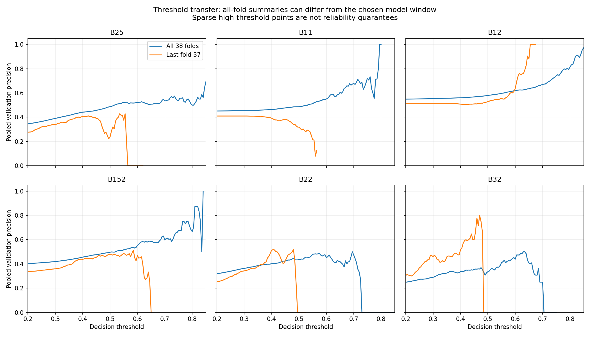

# Validation eşik bölgeleri ve test modeline aktarım

17 Ekim 2026 · exp-017-threshold-transfer · exp-016'nın devamı.

## Ne yapıldı?

Kullanıcının isteğiyle mevcut altı bariyerin 201 eşikteki validation sonuçları
yeniden toplulaştırıldı. Yeni eğitim, yeni etiket üretimi ve Ekim testi yapılmadı.
Kaynak ZIP SHA256:
`76d09912ab27349d003041a4f2356fbe989cbd76601feaa4793d8e342ca16eff`.
Kaynak: [Drive review ZIP](https://drive.google.com/file/d/1EVi4IKX0JNQbByTEIRTAvRmCnJ6lJTPg/view).

İki görünüm ayrı tutuldu: 38 fold × 3 seed tarihsel özet ve yalnızca son fold37'nin
üç modeli. Her adayda 201 × 114 kaynak satırı ve threshold/fold/seed tekilliği
kontrol edildi. Yeni tablo 6 × 2 × 201 = 2412 satırdır.

## Eşik bölgesi tarama kuralı

Bu yeni, betimsel bir sağlamlık kontrolüdür; eski deneyin kabul kuralı değildir.
Her seed için TP ve sinyal sayıları kendi foldları boyunca toplanır. Precision
TP/sinyal olarak hesaplanır; sinyal yoksa tanımsız bırakılır. Bir merkezin ±0,010
çevresindeki beş eşikte üç seed'in de precision'ı hedefe ulaşmalı. Uygun merkezler
arasında en düşük eşik gösterilir; böylece bu koşulu sağlayan merkezler içinde
sinyal sayısı en yüksek olan alınır. Eşitlikte düşük eşik kalır. %60/%65/%70
önceki kullanıcı isteğindeki karşılaştırma seviyeleridir, kabul hedefleri değildir.

Minimum sinyal sayısı için yeni bir başarı sınırı uydurulmadı. Destek miktarı ayrı
gösterildi. Özellikle 1–7 sinyalle oluşan yüksek precision başarılı aday sayılmaz.
Bu sayımlar örtüşen saatler ve seed tekrarları içerir; bağımsız gözlem sayısı değil.
Yeni birleşik precision/recall/F1, eski eşit fold/seed ortalamasından farklıdır.
Önceki sonuçlar düzeltilmedi veya üzerine yazılmadı. AP/BCE eşikten bağımsızdır;
önceki doğrulanmış metrikler geçerlidir.

## Bütün dönemlerde bulunan bölgeler

| Bariyer | %60 merkezi | %65 merkezi | %70 merkezi | Açıklama |
|---|---:|---:|---:|---|
| 2/5 | Yok | Yok | Yok | Üç seed ve komşu eşik koşulu sağlanmıyor |
| 1/1 | 0,710 | Yok | Yok | Merkezde en az sinyalli seed yalnızca 7 sinyal |
| 1/2 | 0,575 | 0,705 | 0,755 | Merkezlerde en az sinyalli seed: 15619 / 1038 / 209 |
| 1,5/2 | 0,780 | 0,780 | Yok | Merkezde en az sinyalli seed yalnızca 3 sinyal |
| 2/2 | Yok | Yok | Yok | Üç seed ve komşu eşik koşulu sağlanmıyor |
| 3/2 | Yok | Yok | Yok | Üç seed ve komşu eşik koşulu sağlanmıyor |

"Yok" bu açık tarama kuralına göre bölge bulunmadığı anlamına gelir; modelin her
eşiğinin başarısız olduğu veya farklı bir hedefin de olanaksız olduğu iddiası değil.

## Model seçimi için somut öneri

2026 verisiyle tekrar eğitim yapılmadan mevcut modeller kullanılacaksa, bütün
bariyerlerde takvim bakımından son tamamlanmış fold37 ve seed42/43/44 kullanılsın.
Bu seçim model performansına göre fold seçmez. Her modelin kendi minimum
validation BCE epoch'u zaten kaydedilmiş; son epoch ağırlıklarıyla karıştırılmamalı.

- Train: 15 Mart 2025 04:00 – 11 Ekim 2025 03:00 UTC, 5040 satır.
- Validation: 12 Ekim 2025 04:00 – 26 Kasım 2025 03:00 UTC, 1080 satır.
- Diziler: train4977 / validation1017. Üç seed; ensemble kuralı eklenmedi.
- Ekim 2026'ya yaklaşık 10 aylık model eskimesi bulunur. Sonuç, bu tarihsel
  modellerin ileri döneme aktarımı olarak yorumlanmalı; güncel yeniden eğitilmiş
  model performansı olarak sunulmamalı.
- 18 modelin epoch ve dosya yolları `proposed_models.csv` içindedir. ZIP ağırlıkları
  içermediğinden checkpoint içerikleri bu incelemede doğrulanmadı; yürütücü bunların
  içindeki en iyi ağırlıkları ve scaler kimliğini testten önce doğrulamalı.
- B32 seed44 fold37 kurtarma sırasında yeniden eğitilen modeldir. Fold34'ün eksik
  ağırlığı bu model grubuna dahil değildir. Hiçbir checkpoint değiştirilmedi.

## Aktarımda bulunan sorun

B12 için genel özetin %65/%70 merkezleri 0,705/0,755 iken, fold37'nin üç seed'i
de bu eşiklerde hiç sinyal vermiyor. Dolayısıyla genel taramadan çıkan eşikleri
son pencere modellerine taşımak, aynı validation başarısının korunacağını göstermiyor.

Fold37'de aynı bölge kuralı B12 için %60 merkezini 0,620 buluyor; en az sinyalli
seed yalnızca 18 sinyal veriyor. %65 ve %70 merkezleri 0,640; en az sinyalli seed
yalnızca 2 sinyal veriyor. Diğer beş bariyerde bölge bulunmuyor. Bu nedenle altı
model için güçlü dayanaklı altı "en iyi eşik" bulunmuş gibi test kilidi üretilmedi.

Örnek: B12 fold37'de 0,565 eşiği seed42/43/44 için sırasıyla 93/460/152 sinyal
ve %68,8/%48,5/%71,1 precision verir. Seedler arasındaki farkı genel ortalama örter.

## Teste hazırlık kararı

1. 0,50 referans korunur; kullanıcı örneği 0,40 aynı tabloda ayrıca gösterilir.
2. `threshold_comparison.csv` bütün eşikleri içerir; `reference_040_050.csv`
   küçük karşılaştırmadır. Precision, recall, F1, sinyal sayısı, sinyalsiz oran ve
   en düşük seed desteği birlikte okunur.
3. Mevcut kanıt, her bariyer için güvenilir yüksek-precision ana eşik kilitlemeye
   yeterli değil. Özellikle birkaç sinyal üzerinden yeni bir ana eşik seçilmedi.
4. Önerilen test kapsamı: 2 Ekim 2026 00:00 – 14 Ekim 2026 23:00 UTC, 312 saat;
   son etiket mumu 15 Ekim 09:00 UTC. Fiyatlar, etiketler, metrikler açılmadı.
5. Sonraki test, önceden yazılmış senaryo karşılaştırması olabilir: 0,40/0,50
   referansları ve validation'dan gelen betimsel bölgeler. Ana eşik başarısı iddiası
   için yeterli sinyal ve precision kabul ölçütü ayrıca tanımlanmalı. Testte
   kazanan eşik aranmamalı. Yeni eğitim bu analiz için gerekli değildi.

Bu belge bir test yürütücüsü veya tamamlanmış test kilidi değildir. Mevcut
notebooku tekrar çalıştırma talimatı içermez. Epoch seçimi ve eşik incelemesinin
aynı validation'a dayanması iyimserlik sınırını korur; seed tekrarları bağımsız
piyasa dönemleri değildir.

